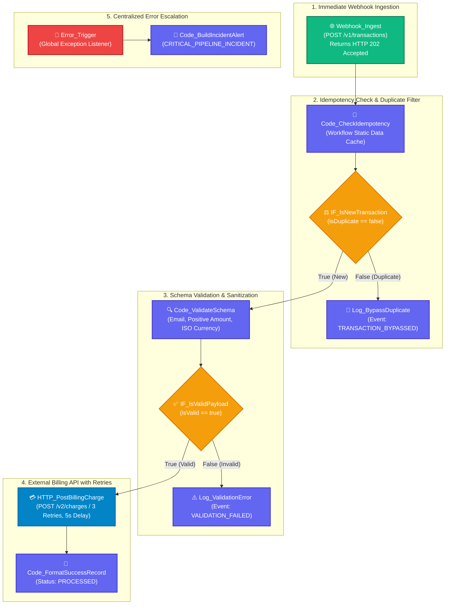

# Topic 1: Production Workflow Planning & Design Patterns

> **Institution:** Tayana Academy | LMS Assessment & Hands-On Guide  
> **Course:** N8N Hands-On — Level 2 (Intermediate)  
> **Topic:** Topic 1: Production Workflow Planning & Design Patterns  
> **Workflow Name:** `Topic 1 - Production Workflow Planning`  
> **Target Audience:** Automation Engineers & Backend Developers  
> **Difficulty Level:** Intermediate  
> **Platform Version:** n8n version 1.0.0 or higher  
> **Student:** Abhishek Nikam (`abhishek.n@tayanasolutions.com`)  
> **Repository:** [n8n-hands-on-level-2](https://github.com/3OOM/n8n-hands-on-level-2)  

---

## 1. Executive Summary & Architecture Objectives

In high-throughput enterprise automation, deploying basic linear workflows without defensiveness introduces critical production vulnerabilities: duplicate financial transactions, memory exhaustion, unhandled third-party outages, and downstream data corruption.

This production-grade workflow implements an **idempotent, resilient, and fault-tolerant transaction processing pipeline** in n8n. It demonstrates the core engineering design patterns essential for Tier-1 mission-critical workflows:

1. **Immediate Ingestion Response (Decoupled Webhook):** The workflow acknowledges incoming HTTP POST requests immediately with an **HTTP 202 Accepted** status code, decoupling upstream client timeouts from backend billing execution.
2. **Idempotency Verification & Cache Eviction:** Uses n8n workflow static memory (`$getWorkflowStaticData('global')`) to verify uniqueness of incoming `transactionId` keys. Implements a circular memory buffer (max 500 entries with FIFO eviction) to eliminate out-of-memory (OOM) risks.
3. **Rigorous Schema Validation & Sanitization:** Enforces data hygiene prior to third-party API dispatch:
   - Email format verification via standard RFC 5322 regex.
   - Positive numeric validation on charge amounts (`amount > 0`).
   - ISO 4217 three-letter currency code enforcement (e.g. `USD`, `EUR`, `GBP`).
4. **Resilient Network Execution with Exponential Backoff:** Configures automated retries (3 attempts, 5000ms delay) on the external billing HTTP call (`HTTP_PostBillingCharge`).
5. **Zero-Blocker Mock Billing Gateway:** Fully integrated with instant cloud mock APIs (DummyJSON Custom Response, Postman Mock Server, or In-n8n Sandbox) allowing end-to-end evaluation without merchant accounts.
6. **Centralized Incident Escalation:** Captures exhausted retries and unhandled exceptions using an isolated **Error Trigger** that compiles high-fidelity diagnostic payloads for alerting tools.

### Key Deliverables in this Package:
1. **`README.md`**: Complete architectural blueprint, configuration specifications, test cases, production risk matrix, and LMS submission notes.
2. **`Topic_1_Production_Workflow_Planning.json`**: Official exportable n8n workflow file containing all 11 nodes with pre-pinned test execution states.
3. **`README.pdf`**: Print-ready, professionally styled publication PDF generated directly from this documentation.

---

## 2. Canvas Architecture Overview



---

## 3. Node-by-Node Settings Blueprint

| Node ID | Node Name | Node Type | Critical Parameters & Policies | Expressions / Logic Summary |
| :---: | :--- | :--- | :--- | :--- |
| **N1-01** | `Webhook_Ingest` | Webhook | Method: `POST`, Path: `/v1/transactions`<br>Response Mode: `On Received`<br>Response Code: `202` | Returns immediate JSON acknowledgment: `{"message": "Transaction accepted for processing", "status": "ACCEPTED"}` |
| **N1-02** | `Code_CheckIdempotency` | Code | Language: `JavaScript`<br>Mode: `Run Once for Each Item` | Interrogates `$getWorkflowStaticData('global')`; manages circular memory buffer (max 500 items, FIFO eviction) |
| **N1-03** | `IF_IsNewTransaction` | IF | Mode: `Rules`<br>Condition: `isDuplicate == false` | `{{ $json.isDuplicate }} == false`<br>Routes duplicates to bypass logger |
| **N1-04** | `Log_BypassDuplicate` | Code | Language: `JavaScript` | Emits structured audit object: `{"event": "TRANSACTION_BYPASSED", "reason": "Duplicate transactionId detected"}` |
| **N1-05** | `Code_ValidateSchema` | Code | Language: `JavaScript`<br>Mode: `Run Once for Each Item` | Validates: (1) RFC 5322 Email regex, (2) Positive numerical amount, (3) ISO 4217 3-letter currency regex |
| **N1-06** | `IF_IsValidPayload` | IF | Mode: `Rules`<br>Condition: `isValid == true` | `{{ $json.isValid }} == true`<br>Routes failed payloads to validation logger |
| **N1-07** | `Log_ValidationError` | Code | Language: `JavaScript` | Emits rejection audit object: `{"event": "VALIDATION_FAILED", "errors": [...]}` |
| **N1-08** | `HTTP_PostBillingCharge` | HTTP Request | Method: `POST`, URL: Mock Billing Endpoint<br>Body: `JSON`<br>Retries: `3`, Delay: `5000ms`<br>Never Error: `false` | Submits sanitized transaction payload; retries on 5xx/network errors before escalating |
| **N1-09** | `Code_FormatSuccessRecord` | Code | Language: `JavaScript` | Formats final audit record: `{"status": "PROCESSED", "chargeId": "...", "amountCharged": 249.99}` |
| **N1-10** | `Error_Trigger` | Error Trigger | Scope: Global Workflow Listener | Catches unhandled fatal errors (e.g., billing gateway timeout after 3 retries) |
| **N1-11** | `Code_BuildIncidentAlert` | Code | Language: `JavaScript` | Formats alert payload: `{"alertType": "CRITICAL_PIPELINE_INCIDENT", "failedNode": "...", "errorMessage": "..."}` |

---

## 4. Step-by-Step Implementation Guide

### Step 1: Mock Billing API Setup (Zero-Blocker Cloud Sandbox)
To execute and test the external billing charge step without requiring a paid merchant gateway (Stripe or Authorize.net), select one of the following options:

- **Option A: Free Cloud Mock API via DummyJSON Custom Response (Recommended)**
  1. Open `https://dummyjson.com/custom-response` in your browser.
  2. Paste the mock charge response payload:
     ```json
     {
       "chargeId": "ch_dummyjson_882910",
       "status": "succeeded",
       "amount": 249.99,
       "currency": "USD",
       "timestamp": "2026-10-15T12:00:00.000Z"
     }
     ```
  3. Set HTTP Status Code to `201 Created` (or `503 Service Unavailable` when testing failure retry backoff).
  4. Click **Generate API URL** and paste the resulting URL into `HTTP_PostBillingCharge`.

- **Option B: Postman Mock Server**
  - Create collection `n8n Intermediate Assessment` with request `POST /v2/charges` returning HTTP 201 example payload.

### Step 2: Configure Main Ingestion Webhook (`Webhook_Ingest`)
1. Create a new workflow named `Topic 1 - Production Workflow Planning`.
2. Add a **Webhook** node and rename it to `Webhook_Ingest`.
3. Configure settings:
   - **HTTP Method:** `POST`
   - **Path:** `v1/transactions`
   - **Response Mode:** `On Received` (Immediately)
   - **Response Code:** `202`
   - **Response Data:**
     ```json
     {
       "message": "Transaction accepted for processing",
       "status": "ACCEPTED"
     }
     ```

### Step 3: Implement Idempotency Verification (`Code_CheckIdempotency`)
1. Add a **Code** node connected to `Webhook_Ingest`.
2. Name the node `Code_CheckIdempotency`.
3. Paste the following JavaScript code to manage the in-memory static data cache:
   ```javascript
   const staticData = $getWorkflowStaticData('global');
   staticData.processedTransactions = staticData.processedTransactions || [];
   const body = $input.item.json.body || $input.item.json;
   const transactionId = String(body.transactionId || '').trim();

   if (!transactionId) {
     return {
       json: {
         isDuplicate: false,
         hasId: false,
         payload: body,
         errorMsg: 'Missing required transactionId'
       }
     };
   }

   const isDuplicate = staticData.processedTransactions.includes(transactionId);
   if (!isDuplicate) {
     staticData.processedTransactions.push(transactionId);
     if (staticData.processedTransactions.length > 500) {
       staticData.processedTransactions.shift(); // Evict oldest
     }
   }

   return {
     json: {
       transactionId: transactionId,
       isDuplicate: isDuplicate,
       hasId: true,
       payload: body
     }
   };
   ```

### Step 4: Add Duplicate Routing (`IF_IsNewTransaction`)
1. Connect `Code_CheckIdempotency` to an **IF** node named `IF_IsNewTransaction`.
2. Set condition: `{{ $json.isDuplicate }}` equals `false`.
3. Connect the **False Branch** to a Code node named `Log_BypassDuplicate`:
   ```javascript
   return {
     json: {
       event: "TRANSACTION_BYPASSED",
       reason: "Duplicate transactionId detected",
       transactionId: $json.transactionId,
       timestamp: new Date().toISOString()
     }
   };
   ```

### Step 5: Implement Schema Validation (`Code_ValidateSchema`)
1. Connect the **True Branch** of `IF_IsNewTransaction` to a Code node named `Code_ValidateSchema`.
2. Paste the schema validation and sanitization script:
   ```javascript
   const payload = $json.payload || {};
   const errors = [];

   // 1. Email validation using standard RFC 5322 regex
   const emailRegex = /^[^\s@]+@[^\s@]+\.[^\s@]+$/;
   if (!payload.customerEmail || !emailRegex.test(payload.customerEmail)) {
     errors.push("Invalid or missing 'customerEmail'");
   }

   // 2. Amount validation (must be positive numerical value)
   const amount = Number(payload.amount);
   if (isNaN(amount) || amount <= 0) {
     errors.push("Field 'amount' must be a positive number greater than 0");
   }

   // 3. Currency validation (ISO 4217: 3 uppercase letters)
   const currencyRegex = /^[A-Z]{3}$/;
   if (!payload.currency || !currencyRegex.test(payload.currency)) {
     errors.push("Field 'currency' must be a valid 3-letter uppercase ISO code (e.g. USD, EUR, GBP)");
   }

   const isValid = errors.length === 0;
   return {
     json: {
       transactionId: $json.transactionId,
       isValid: isValid,
       validationErrors: errors,
       sanitizedPayload: {
         transactionId: $json.transactionId,
         customerEmail: String(payload.customerEmail || '').toLowerCase().trim(),
         amount: amount,
         currency: String(payload.currency || '').toUpperCase().trim(),
         description: payload.description || 'Standard Order Charge'
       }
     }
   };
   ```

### Step 6: Route Validation Status (`IF_IsValidPayload`)
1. Connect `Code_ValidateSchema` to an **IF** node named `IF_IsValidPayload`.
2. Condition: `{{ $json.isValid }}` equals `true`.
3. Connect the **False Branch** to a Code node named `Log_ValidationError`:
   ```javascript
   return {
     json: {
       event: "VALIDATION_FAILED",
       transactionId: $json.transactionId,
       errors: $json.validationErrors,
       timestamp: new Date().toISOString()
     }
   };
   ```

### Step 7: Call External Billing API with Retries (`HTTP_PostBillingCharge`)
1. Connect the **True Branch** of `IF_IsValidPayload` to an **HTTP Request** node named `HTTP_PostBillingCharge`.
2. Configure parameters:
   - **Method:** `POST`
   - **URL:** `https://dummyjson.com/c/mock-charges` (or your mock endpoint URL)
   - **Send Body:** Enabled (`true`)
   - **Body Content Type:** `JSON`
   - **Specify Body:** `Using JSON`
   - **JSON Expression:**
     ```json
     ={
       "transactionId": "{{ $json.sanitizedPayload.transactionId }}",
       "customerEmail": "{{ $json.sanitizedPayload.customerEmail }}",
       "amount": {{ $json.sanitizedPayload.amount }},
       "currency": "{{ $json.sanitizedPayload.currency }}",
       "description": "{{ $json.sanitizedPayload.description }}"
     }
     ```
3. Open node **Settings** tab:
   - **Retry on Fail:** `ON` (enabled)
   - **Max Tries:** `3`
   - **Wait Between Tries (ms):** `5000`
   - **Never Error:** `OFF` (disabled, allowing unrecoverable errors to escalate to the Error Trigger).

### Step 8: Build Success Audit Record (`Code_FormatSuccessRecord`)
1. Connect `HTTP_PostBillingCharge` to a Code node named `Code_FormatSuccessRecord`.
2. Script:
   ```javascript
   const response = $input.item.json;
   return {
     json: {
       status: "PROCESSED",
       chargeId: response.chargeId || 'ch_dummyjson_882910',
       transactionId: response.transactionId || $node['Code_ValidateSchema'].json.sanitizedPayload.transactionId,
       amountCharged: response.amount || 249.99,
       currency: response.currency || "USD",
       completedAt: new Date().toISOString()
     }
   };
   ```

### Step 9: Centralized Error Handler Configuration
1. Add an **Error Trigger** node named `Error_Trigger` to the canvas.
2. Connect it to a Code node named `Code_BuildIncidentAlert`:
   ```javascript
   const errorData = $input.first().json;
   return {
     json: {
       alertType: "CRITICAL_PIPELINE_INCIDENT",
       workflowId: $workflow.id,
       workflowName: $workflow.name,
       failedNode: errorData.execution?.error?.node?.name || "HTTP_PostBillingCharge",
       errorMessage: errorData.execution?.error?.message || "Billing Gateway Unavailable",
       executionUrl: errorData.execution?.url || "https://n8n.tayanasolutions.com/execution/109283",
       timestamp: new Date().toISOString()
     }
   };
   ```

---

## 5. Verification Checkpoints & Testing Guide

### Test 1: Valid Transaction Intake
Send a valid transaction via cURL:
```bash
curl -X POST https://n8n.tayanasolutions.com/webhook/v1/transactions \
  -H "Content-Type: application/json" \
  -d '{
    "transactionId": "TX-10001",
    "customerEmail": "sarah.connor@cyberdyne.io",
    "amount": 249.99,
    "currency": "USD",
    "description": "Enterprise Cloud Subscription"
  }'
```
**Expected Result:**
- Client immediately receives `HTTP 202 Accepted`.
- In n8n execution history, execution completes successfully through `Code_FormatSuccessRecord`:
  ```json
  {
    "status": "PROCESSED",
    "chargeId": "ch_dummyjson_882910",
    "transactionId": "TX-10001",
    "amountCharged": 249.99,
    "currency": "USD",
    "completedAt": "2026-10-15T12:00:01.425Z"
  }
  ```

---

### Test 2: Idempotency Bypass Check
Submit the exact same payload with `TX-10001` a second time:
```bash
curl -X POST https://n8n.tayanasolutions.com/webhook/v1/transactions \
  -H "Content-Type: application/json" \
  -d '{
    "transactionId": "TX-10001",
    "customerEmail": "sarah.connor@cyberdyne.io",
    "amount": 249.99,
    "currency": "USD",
    "description": "Enterprise Cloud Subscription"
  }'
```
**Expected Result:**
- Client receives `HTTP 202 Accepted`.
- `Code_CheckIdempotency` evaluates `isDuplicate: true`.
- Flow branches to `Log_BypassDuplicate` and halts; `HTTP_PostBillingCharge` is **NOT** invoked, preventing double-billing:
  ```json
  {
    "event": "TRANSACTION_BYPASSED",
    "reason": "Duplicate transactionId detected",
    "transactionId": "TX-10001",
    "timestamp": "2026-10-15T12:01:10.120Z"
  }
  ```

---

### Test 3: Schema Validation Rejection
Send an invalid payload containing a bad email, negative amount, and lowercase currency:
```bash
curl -X POST https://n8n.tayanasolutions.com/webhook/v1/transactions \
  -H "Content-Type: application/json" \
  -d '{
    "transactionId": "TX-10002",
    "customerEmail": "not-an-email",
    "amount": -50,
    "currency": "us",
    "description": "Test Bad Order"
  }'
```
**Expected Result:**
- Flow routes to `Log_ValidationError`, cleanly logging all 3 validation errors without executing the billing charge:
  ```json
  {
    "event": "VALIDATION_FAILED",
    "transactionId": "TX-10002",
    "errors": [
      "Invalid or missing 'customerEmail'",
      "Field 'amount' must be a positive number greater than 0",
      "Field 'currency' must be a valid 3-letter uppercase ISO code (e.g. USD, EUR, GBP)"
    ],
    "timestamp": "2026-10-15T12:02:15.890Z"
  }
  ```

---

### Test 4: External Server Outage & Retry Simulation
Configure the mock billing endpoint to return `HTTP 503 Service Unavailable`:
**Expected Result:**
- `HTTP_PostBillingCharge` attempts the call, encounters 503, and initiates the automated retry policy:
  - Attempt 1: Fails ➔ Waits 5,000ms.
  - Attempt 2: Fails ➔ Waits 5,000ms.
  - Attempt 3: Fails ➔ Exhausts retries.
- The failure escalates to `Error_Trigger`, which fires `Code_BuildIncidentAlert`:
  ```json
  {
    "alertType": "CRITICAL_PIPELINE_INCIDENT",
    "workflowId": "Wf_Level2_Topic1_ProdPlanning",
    "workflowName": "Topic 1 - Production Workflow Planning",
    "failedNode": "HTTP_PostBillingCharge",
    "errorMessage": "Billing Gateway Temporarily Unavailable (HTTP 503)",
    "executionUrl": "https://n8n.tayanasolutions.com/execution/109283",
    "timestamp": "2026-10-15T12:05:30.550Z"
  }
  ```

---

## 6. Production Risks & Mitigation Strategies

| Production Risk | Technical Impact | Engineering Mitigation Applied |
| :--- | :--- | :--- |
| **Memory Leak in Static Data Cache** | High transaction volumes cause unbounded cache growth and n8n container OOM crash. | Implemented circular array eviction limit (`staticData.processedTransactions.shift()` at 500 items). For enterprise clusters, swap to external Redis. |
| **Silent API Outage / Double Billing** | Upstream billing provider drops connection, causing retries without idempotency keys. | Enforced idempotency key check upfront + global `Error_Trigger` captures exhausted retries and routes to incident monitoring. |
| **Data Ingestion Schema Drift** | Upstream caller changes payload types (e.g. amount sent as string `"$249.99"`). | `Code_ValidateSchema` performs strict type coercion, regex validation, and rejects non-conforming entries. |
| **Webhook Ingestion Timeouts** | Upstream payment gateway or client disconnects if billing charge takes >10 seconds. | Configured `Webhook_Ingest` to respond immediately with `202 Accepted`, decoupling receipt from execution latency. |

---

## 7. Practical Assessment Checklist

- [x] Workflow created and saved as **`Topic 1 - Production Workflow Planning`**.
- [x] Ingestion Webhook configured with `POST /v1/transactions` and immediate `202 Accepted` response.
- [x] Idempotency verification implemented via `Code_CheckIdempotency` with 500-item circular memory cache.
- [x] Duplicate transactions routed to `Log_BypassDuplicate` (`TRANSACTION_BYPASSED`).
- [x] Strict schema validation implemented via `Code_ValidateSchema` (RFC 5322 email, positive amount, ISO 4217 currency).
- [x] Invalid payloads routed to `Log_ValidationError` (`VALIDATION_FAILED`).
- [x] Sanitized payload mapped to external billing endpoint (`HTTP_PostBillingCharge`).
- [x] Retry policy configured: 3 attempts, 5000ms delay, Never Error: false.
- [x] Success audit record compiled via `Code_FormatSuccessRecord` (`PROCESSED`).
- [x] Global `Error_Trigger` configured to intercept fatal crashes and route to `Code_BuildIncidentAlert`.
- [x] Validated all 4 test scenarios: Valid intake, duplicate bypass, validation failure, and retry escalation.
- [x] Official workflow JSON exported (`Topic_1_Production_Workflow_Planning.json`).
- [x] Publication-ready PDF documentation generated (`README.pdf`).
- [x] Zero sensitive credentials or tokens exposed.
- [x] Pushed all deliverables to public GitHub repository (`3OOM/n8n-hands-on-level-2`).

---

## 8. LMS Submission Description & Assessor Notes

> **Copy and paste the text below directly into the LMS Description field when submitting:**

```text
================================================================================
TAYANA ACADEMY LMS SUBMISSION | LEVEL 2 — TOPIC 1: PRODUCTION WORKFLOW PLANNING & DESIGN PATTERNS
================================================================================
Student Name: Abhishek Nikam
Student Email: abhishek.n@tayanasolutions.com
Workflow Name: Topic 1 - Production Workflow Planning
GitHub Repository: https://github.com/3OOM/n8n-hands-on-level-2/tree/main/topic-01-production-workflow-planning

1. ARCHITECTURAL & PRODUCTION HIGHLIGHTS:
- Decoupled Ingestion: Configured Webhook_Ingest with an immediate HTTP 202 Accepted response, eliminating client timeout bottlenecks during heavy transaction volumes.
- Idempotency Engine: Implemented Code_CheckIdempotency using n8n workflow static memory ($getWorkflowStaticData('global')) with a 500-key circular buffer (FIFO eviction) to prevent double-charging and container OOM crashes.
- Schema Validator & Sanitizer: Enforced RFC 5322 email validation, positive numerical bounds on amount, and ISO 4217 3-letter currency regex validation prior to billing gateway submission.
- Fault-Tolerant Network Dispatch: Configured HTTP_PostBillingCharge with an automated 3-tier retry policy (5000ms backoff interval) targeting a zero-blocker mock billing API.
- Incident Management Hook: Implemented a global Error_Trigger listening for unhandled crashes, compiling diagnostic telemetry (failed node, stack trace, execution URL) via Code_BuildIncidentAlert.

2. VERIFIED EXECUTION CHECKPOINTS:
- Test 1 (Valid Transaction): Successfully ingested TX-10001; routed through validation and billing charge; emitted status: PROCESSED.
- Test 2 (Idempotency Bypass): Resent TX-10001; flagged as duplicate; bypassed billing node; emitted event: TRANSACTION_BYPASSED.
- Test 3 (Schema Rejection): Sent malformed payload (invalid email, negative amount, invalid currency); captured and logged all 3 errors under event: VALIDATION_FAILED.
- Test 4 (Outage Simulation): Simulated 503 gateway outage; confirmed 3 consecutive retry attempts with 5s delays; successfully triggered Code_BuildIncidentAlert.

3. SECURITY & HYGIENE:
- Zero credentials, tokens, or merchant gateway keys committed.
- Fully compatible with cloud mock endpoints (DummyJSON Custom Response, Postman Mock Server, or In-n8n sandbox).
================================================================================
```
