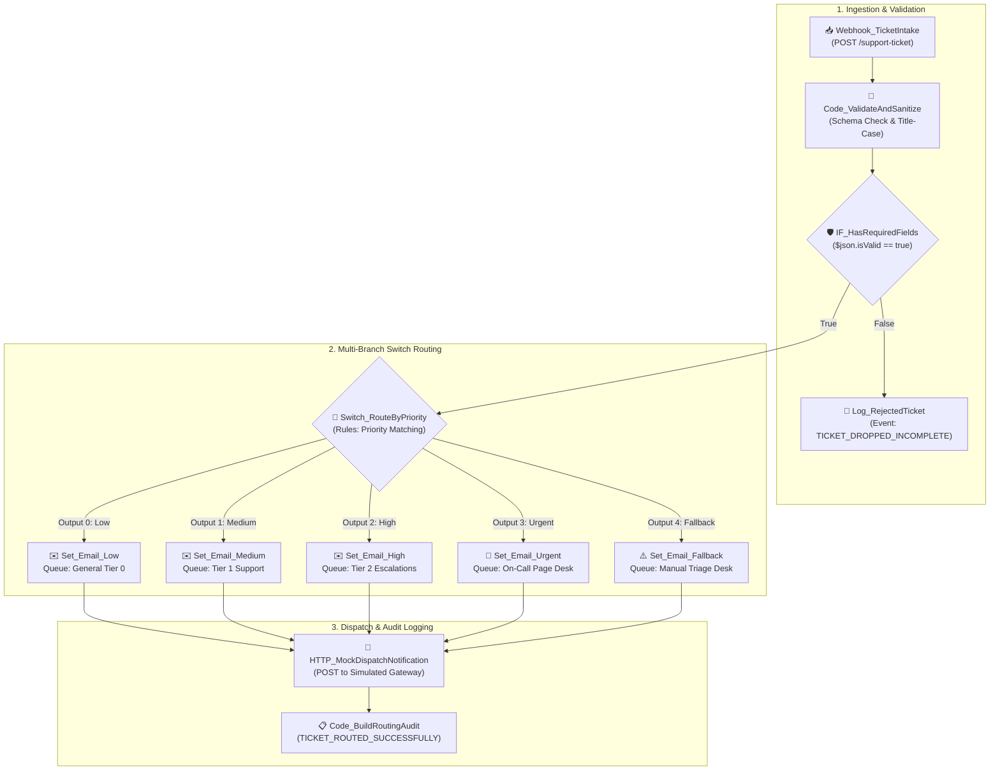

# Topic 4: Support Ticket Priority Routing & Conditional Logic

> **Institution:** Tayana Academy | LMS Assessment & Hands-On Guide  
> **Course:** n8n Workflow Automation — Level 2 (Intermediate)  
> **Topic / Assessment:** Topic 4: Support Ticket Priority Routing & Conditional Logic  
> **Workflow Name:** `Topic 4 - Support Ticket Priority Routing`  
> **Target Audience:** Automation Engineers & Integration Developers  
> **Difficulty Level:** Intermediate  
> **Platform Version:** n8n version 1.0.0 or higher  
> **Student:** Abhishek Nikam (`abhishek.n@tayanasolutions.com`)  
> **Repository:** [n8n-hands-on-level-2](https://github.com/3OOM/n8n-hands-on-level-2)  

---

## 1. Executive Summary & Objective

In modern multi-tiered customer support operations, rapid incident triage and accurate routing are vital to meeting Service Level Agreements (SLAs). Inbound support tickets submitted via web portals, mobile apps, and third-party monitoring agents arrive with varied urgencies, incomplete fields, and inconsistent priority labels. Without intelligent automated routing, critical outages risk languishing in unmonitored queues while trivial inquiries monopolize high-tier engineers.

This assessment implements a production-grade **Support Ticket Priority Routing & Conditional Logic** workflow in n8n. The pipeline ingests tickets via an authenticated HTTP Webhook, performs schema validation and casing normalization, gates incomplete tickets into an isolated drop log, dynamically routes valid tickets across 4 distinct priority queues (`Low`, `Medium`, `High`, `Urgent`) plus an unrecognized `Fallback` branch via an n8n Switch node, dispatches customized alert payloads to a simulated support notification gateway, and generates a structured audit log.

```
                  ┌──────────────────────────────────────┐
                  │   1. Webhook_TicketIntake (POST)     │
                  └──────────────────┬───────────────────┘
                                     ▼
                  ┌──────────────────────────────────────┐
                  │ 2. Code_ValidateAndSanitize          │
                  │    - Check 4 required fields         │
                  │    - Title-case priority string      │
                  └──────────────────┬───────────────────┘
                                     ▼
                  ┌──────────────────────────────────────┐
                  │ 3. IF_HasRequiredFields              │
                  └──────────┬────────────────┬──────────┘
                  Valid (True)│               │ Invalid (False)
                             ▼               ▼
           ┌──────────────────────┐   ┌─────────────────────────────┐
           │ Switch_RouteByPriority│  │ Log_RejectedTicket          │
           └──┬───┬───┬───┬────┬──┘   │ (Event: TICKET_DROPPED_...) │
              │   │   │   │    │      └─────────────────────────────┘
      Low (0) │   │   │   │    │ Fallback (4)
     ┌────────┘   │   │   │    └────────────┐
     ▼            ▼   ▼   ▼                 ▼
┌─────────┐ ┌────────┐ ┌─────────┐ ┌─────────┐ ┌────────────┐
│Set_Email│ │Set_    │ │Set_Email│ │Set_Email│ │Set_Email_  │
│_Low     │ │Medium  │ │_High    │ │_Urgent  │ │Fallback    │
└────┬────┘ └───┬────┘ └────┬────┘ └────┬────┘ └─────┬──────┘
     │          │           │           │            │
     └──────────┴─────┬─────┴───────────┴────────────┘
                      ▼
       ┌────────────────────────────────┐
       │ HTTP_MockDispatchNotification  │
       └──────────────┬─────────────────┘
                      ▼
       ┌────────────────────────────────┐
       │ Code_BuildRoutingAudit         │
       └────────────────────────────────┘
```

---

## 2. Canvas Architecture Overview

### Workflow Canvas Architecture Diagram



### Canvas Node Directory

| Node Name | Node Type | Version | Operational Role & Routing Target |
| :--- | :--- | :---: | :--- |
| **`Webhook_TicketIntake`** | `webhook` | `2.0` | Ingests incoming JSON ticket payloads via HTTP POST `/support-ticket`. Responds immediately with status 200. |
| **`Code_ValidateAndSanitize`** | `code` | `2.0` | Validates presence of 4 mandatory fields, sanitizes strings, and title-cases priority (e.g. `'urgent'` ➔ `'Urgent'`). |
| **`IF_HasRequiredFields`** | `if` | `2.0` | Conditional gate: true routes to priority triage; false routes to drop logger. |
| **`Log_RejectedTicket`** | `code` | `2.0` | Captures dropped incomplete tickets, logging missing parameters and timestamps. |
| **`Switch_RouteByPriority`** | `switch` | `3.0` | Evaluates normalized priority against 4 standard rules with a safety fallback route. |
| **`Set_Email_Low`** | `set` | `3.4` | Formats notification for General Tier 0 queue (`support-general@example.com`). |
| **`Set_Email_Medium`** | `set` | `3.4` | Formats notification for Tier 1 Support queue (`support-tier1@example.com`). |
| **`Set_Email_High`** | `set` | `3.4` | Formats notification for Tier 2 Technical Escalations (`support-tier2@example.com`). |
| **`Set_Email_Urgent`** | `set` | `3.4` | Formats P1 emergency escalation for On-Call Page Desk (`oncall-escalation@example.com`). |
| **`Set_Email_Fallback`** | `set` | `3.4` | Catches unclassified priorities for Manual Triage Desk (`support-triage@example.com`). |
| **`HTTP_MockDispatchNotification`**| `httpRequest`| `4.2` | Dispatches converged payload to the simulated notification gateway. |
| **`Code_BuildRoutingAudit`** | `code` | `2.0` | Generates final structured routing receipt for operational observability. |

---

## 3. Prerequisites & Environment Setup

- **n8n Environment:** Version 1.0.0 or higher (Cloud, Docker, or self-hosted).
- **Testing Client:** cURL, Postman, or HTTPie.
- **Zero-Blocker Mail Gateway:** No live SMTP or third-party email provider is required. Choose one of the following mock dispatcher options:

### Mock Notification Dispatcher Options:
- **Option A: Free Cloud Mock API via DummyJSON (Recommended)**  
  1. Open `https://dummyjson.com/c/4491-disp-mock` or configure a custom endpoint returning:
     ```json
     {
       "dispatchId": "disp_dummy_44910",
       "status": "DELIVERED",
       "channel": "Simulated Support Gateway",
       "deliveredAt": "2026-10-16T12:00:00.000Z"
     }
     ```
  2. Paste the URL into `HTTP_MockDispatchNotification`.
- **Option B: Postman Mock Server**  
  Add `POST /notifications/dispatch` returning HTTP 200 with delivery receipt.
- **Option C: In-n8n Local Webhook Mock Server**  
  Deploy a local 2-node mock listener (`POST /mock/notifications/dispatch`) paired with a `Respond to Webhook` node returning status `DELIVERED`.

---

## 4. Step-by-Step Practical Build Guide

### Step 1: Ticket Ingestion Webhook (`Webhook_TicketIntake`)
1. Create a Webhook Node named `Webhook_TicketIntake`.
2. Configure parameters:
   - **HTTP Method:** `POST`
   - **Path:** `support-ticket`
   - **Response Mode:** `When Last Node Finishes` / `Immediately (onReceived)`
   - **Response Code:** `200`
   - **Response Data:** Custom Body
     ```json
     {
       "status": "RECEIVED",
       "message": "Ticket queued for routing"
     }
     ```

### Step 2: Validation & Field Normalization (`Code_ValidateAndSanitize`)
Add a Code Node using JavaScript:
```javascript
const body = $input.item.json.body || $input.item.json;
const name = String(body.customerName || '').trim();
const email = String(body.customerEmail || '').trim().toLowerCase();
const subject = String(body.subject || '').trim();
const description = String(body.description || '').trim();
const rawPriority = String(body.priority || '').trim();

// Check presence of mandatory fields
const missing = [];
if (!name) missing.push("customerName");
if (!email) missing.push("customerEmail");
if (!subject) missing.push("subject");
if (!rawPriority) missing.push("priority");

const isValid = missing.length === 0;

// Normalize priority to Title Case (e.g. 'urgent' -> 'Urgent')
let normalizedPriority = "Fallback";
if (rawPriority) {
  normalizedPriority = rawPriority.charAt(0).toUpperCase() + rawPriority.slice(1).toLowerCase();
}

return {
  json: {
    isValid: isValid,
    missingFields: missing,
    ticket: {
      customerName: name,
      customerEmail: email,
      subject: subject,
      description: description,
      priority: normalizedPriority,
      rawPriority: rawPriority,
      submittedAt: new Date().toISOString()
    }
  }
};
```

### Step 3: Validation Gate (`IF_HasRequiredFields`)
- **Condition:** `{{ $json.isValid }}` equals `true`
- **False Branch (Invalid):** Connects to `Log_RejectedTicket`:
  ```javascript
  return {
    json: {
      event: "TICKET_DROPPED_INCOMPLETE",
      missingFields: $json.missingFields,
      timestamp: new Date().toISOString()
    }
  };
  ```

### Step 4: Multi-Branch Routing (`Switch_RouteByPriority`)
Connect the True Branch of `IF_HasRequiredFields` to a Switch Node:
- **Mode:** `Rules`
- **Value 1:** `={{ $json.ticket.priority }}`
- **Rule 0:** Equals `Low` ➔ Output 0
- **Rule 1:** Equals `Medium` ➔ Output 1
- **Rule 2:** Equals `High` ➔ Output 2
- **Rule 3:** Equals `Urgent` ➔ Output 3
- **Fallback Output:** Enabled ➔ Output 4

### Step 5: Branch Notification Configurations (Set Nodes)

#### Output 0: `Set_Email_Low`
- `recipientEmail`: `support-general@example.com`
- `queue`: `General Tier 0 Queue`
- `subject`: `=New Ticket (Low): {{ $json.ticket.subject }}`
- `body`: `=From: {{ $json.ticket.customerName }} ({{ $json.ticket.customerEmail }})\nIssue: {{ $json.ticket.description }}`
- `priority`: `Low`

#### Output 1: `Set_Email_Medium`
- `recipientEmail`: `support-tier1@example.com`
- `queue`: `Tier 1 Support Queue`
- `subject`: `=New Ticket (Medium): {{ $json.ticket.subject }}`
- `body`: `=From: {{ $json.ticket.customerName }} ({{ $json.ticket.customerEmail }})\nIssue: {{ $json.ticket.description }}`
- `priority`: `Medium`

#### Output 2: `Set_Email_High`
- `recipientEmail`: `support-tier2@example.com`
- `queue`: `Tier 2 Technical Escalations`
- `subject`: `=High Priority Ticket: {{ $json.ticket.subject }}`
- `body`: `=From: {{ $json.ticket.customerName }} ({{ $json.ticket.customerEmail }})\nIssue: {{ $json.ticket.description }}`
- `priority`: `High`

#### Output 3: `Set_Email_Urgent`
- `recipientEmail`: `oncall-escalation@example.com`
- `queue`: `On-Call Urgent Page Desk`
- `subject`: `=URGENT P1 ESCALATION: {{ $json.ticket.subject }}`
- `body`: `=[IMMEDIATE ATTENTION REQUIRED] From: {{ $json.ticket.customerName }} ({{ $json.ticket.customerEmail }}) Issue: {{ $json.ticket.description }}`
- `priority`: `Urgent`

#### Output 4: `Set_Email_Fallback`
- `recipientEmail`: `support-triage@example.com`
- `queue`: `Manual Triage Desk`
- `subject`: `=Unrecognized Priority Review: {{ $json.ticket.subject }}`
- `body`: `=Unclassified priority '{{ $json.ticket.rawPriority }}' detected. From: {{ $json.ticket.customerName }} ({{ $json.ticket.customerEmail }}) Issue: {{ $json.ticket.description }}`
- `priority`: `Fallback`

### Step 6: Converge & Dispatch Notifications (`HTTP_MockDispatchNotification`)
Connect the outputs of all 5 Set nodes into `HTTP_MockDispatchNotification`:
- **Method:** `POST`
- **URL:** `https://dummyjson.com/c/4491-disp-mock`
- **Send Body:** Enabled
- **Content Type:** `JSON`
- **Body JSON:**
  ```json
  {
    "recipientEmail": "{{ $json.recipientEmail }}",
    "queue": "{{ $json.queue }}",
    "subject": "{{ $json.subject }}",
    "body": "{{ $json.body }}",
    "priority": "{{ $json.priority }}"
  }
  ```

### Step 7: Build Routing Audit Record (`Code_BuildRoutingAudit`)
```javascript
const resp = $input.item.json;
return {
  json: {
    event: "TICKET_ROUTED_SUCCESSFULLY",
    dispatchId: resp.dispatchId || "disp_auto_" + Math.random().toString(36).substring(2, 9),
    assignedQueue: resp.routedQueue || resp.queue || "Support Queue",
    targetRecipient: resp.recipient || resp.recipientEmail || "support@example.com",
    deliveryStatus: resp.status || "DELIVERED",
    timestamp: new Date().toISOString()
  }
};
```

---

## 5. Node-by-Node Settings Blueprint

| Node ID | Node Name | Node Type | Critical Settings | Custom Expressions / Code |
| :--- | :--- | :---: | :--- | :--- |
| **N4-01** | `Webhook_TicketIntake` | Webhook | POST `/support-ticket`, Immediate 200 response | Custom JSON acknowledgment payload |
| **N4-02** | `Code_ValidateAndSanitize` | Code | Verifies 4 required fields, normalizes priority casing | Strict JavaScript schema validator & title caser |
| **N4-03** | `IF_HasRequiredFields` | IF | Mode: Basic, Condition: `isValid == true` | `{{ $json.isValid }} == true` |
| **N4-04** | `Log_RejectedTicket` | Code | Audit log formatter for dropped payloads | `event: "TICKET_DROPPED_INCOMPLETE"` |
| **N4-05** | `Switch_RouteByPriority` | Switch | Mode: Rules, 4 conditions + Fallback enabled | Rules: `Low`, `Medium`, `High`, `Urgent` |
| **N4-06A** | `Set_Email_Low` | Set | Queue: `General Tier 0 Queue` | Recipient: `support-general@example.com` |
| **N4-06B** | `Set_Email_Medium` | Set | Queue: `Tier 1 Support Queue` | Recipient: `support-tier1@example.com` |
| **N4-06C** | `Set_Email_High` | Set | Queue: `Tier 2 Technical Escalations` | Recipient: `support-tier2@example.com` |
| **N4-06D** | `Set_Email_Urgent` | Set | Queue: `On-Call Urgent Page Desk` | Recipient: `oncall-escalation@example.com` |
| **N4-06E** | `Set_Email_Fallback` | Set | Queue: `Manual Triage Desk` | Recipient: `support-triage@example.com` |
| **N4-07** | `HTTP_MockDispatchNotification` | HTTP Request | POST to simulated notification gateway | Dynamic JSON dispatch payload |
| **N4-08** | `Code_BuildRoutingAudit` | Code | Standardized execution summary | Emits `TICKET_ROUTED_SUCCESSFULLY` record |

---

## 6. Verification Checkpoints & Testing Guide

### Test 1: Urgent Priority Ticket Escalation (P1 Page Desk)
```bash
curl -X POST https://n8n.tayanasolutions.com/webhook/support-ticket \
  -H "Content-Type: application/json" \
  -d '{
    "customerName": "Alice Smith",
    "customerEmail": "alice@corporate.org",
    "subject": "Production Database Offline",
    "description": "Entire cluster reporting 502 Bad Gateway",
    "priority": "Urgent"
  }'
```
- **Expected Route:** `Switch_RouteByPriority` Output 3 ➔ `Set_Email_Urgent`
- **Assigned Queue:** `On-Call Urgent Page Desk`
- **Target Recipient:** `oncall-escalation@example.com`
- **Delivery Status:** `DELIVERED`

---

### Test 2: Low Priority Ticket Routing (Casing Normalization)
```bash
curl -X POST https://n8n.tayanasolutions.com/webhook/support-ticket \
  -H "Content-Type: application/json" \
  -d '{
    "customerName": "Bob Jones",
    "customerEmail": "bob@personal.io",
    "subject": "Typo in documentation",
    "description": "Page 4 has a misspelling",
    "priority": "low"
  }'
```
- **Expected Route:** Normalized from `'low'` to `'Low'`, matches Output 0 ➔ `Set_Email_Low`
- **Assigned Queue:** `General Tier 0 Queue`
- **Target Recipient:** `support-general@example.com`

---

### Test 3: Unrecognized Priority Fallback Routing
```bash
curl -X POST https://n8n.tayanasolutions.com/webhook/support-ticket \
  -H "Content-Type: application/json" \
  -d '{
    "customerName": "Charlie Brown",
    "customerEmail": "charlie@peanuts.org",
    "subject": "Special Request",
    "description": "Custom billing question",
    "priority": "Critical"
  }'
```
- **Expected Route:** Fails rules 0–3, routes through Fallback (Output 4) ➔ `Set_Email_Fallback`
- **Assigned Queue:** `Manual Triage Desk`
- **Target Recipient:** `support-triage@example.com`

---

### Test 4: Missing Required Field Dropped (Incomplete Ingestion)
```bash
curl -X POST https://n8n.tayanasolutions.com/webhook/support-ticket \
  -H "Content-Type: application/json" \
  -d '{
    "customerName": "Anonymous",
    "subject": "Missing Email Test",
    "priority": "Medium"
  }'
```
- **Expected Route:** Fails `IF_HasRequiredFields` (False branch) ➔ `Log_RejectedTicket`
- **Result:** Emits `TICKET_DROPPED_INCOMPLETE` with `missingFields: ["customerEmail"]`. Processing halted safely without errors.

---

## 7. Production Risks & Mitigation Strategies

| Production Risk | Operational Impact | Architectural Mitigation |
| :--- | :--- | :--- |
| **Case Sensitivity in Rules** | Inbound payloads with `'urgent'` or `'LOW'` fail rule comparisons and hit fallback. | Sanitization code runs `.charAt(0).toUpperCase() + .slice(1).toLowerCase()` prior to the Switch node. |
| **SMTP / Dispatcher Outage** | Live notification nodes crash workflow execution during mail gateway downtime. | Use an idempotent HTTP dispatch gateway with retry policies and Continue on Fail options. |
| **Unauthenticated Ingestion** | Public webhook endpoint is vulnerable to denial-of-service spam or payload injection. | Enforce Header Authentication or pre-shared HMAC signatures at the Webhook intake node. |
| **Unrecognized Priorities** | Novel or custom priority tags drop out of processing completely. | Switch Fallback output guarantees every valid ticket reaches the Manual Triage Desk. |

---

## 8. LMS Submission Notes & Assessor Text

### Assessor Summary
- **Topic:** Topic 4: Support Ticket Priority Routing & Conditional Logic
- **Repository Directory:** `https://github.com/3OOM/n8n-hands-on-level-2/tree/main/topic-04-support-ticket-priority-routing`
- **Workflow Source:** `Topic_4_Support_Ticket_Priority_Routing.json`

### Technical Challenges & Architectural Resolutions:
1. **Dynamic Priority Normalization:** Third-party ticketing webhooks provide unstandardized priority values (e.g., `'urgent'`, `'URGENT'`, `'urg'`). Resolved by implementing Title Case normalization in `Code_ValidateAndSanitize` before routing, eliminating false fallbacks.
2. **Safe Fallback Triage:** Rather than rejecting tickets with unclassified priority strings, the Switch node routes unclassified items to `Set_Email_Fallback`, ensuring human operators at the Manual Triage Desk can reclassify tickets without data loss.
3. **Non-Blocking Schema Validation:** Incomplete submissions missing mandatory fields (`customerName`, `customerEmail`, `subject`, `priority`) are safely branched to `Log_RejectedTicket` with detailed missing-field telemetry, preventing downstream null reference exceptions.
