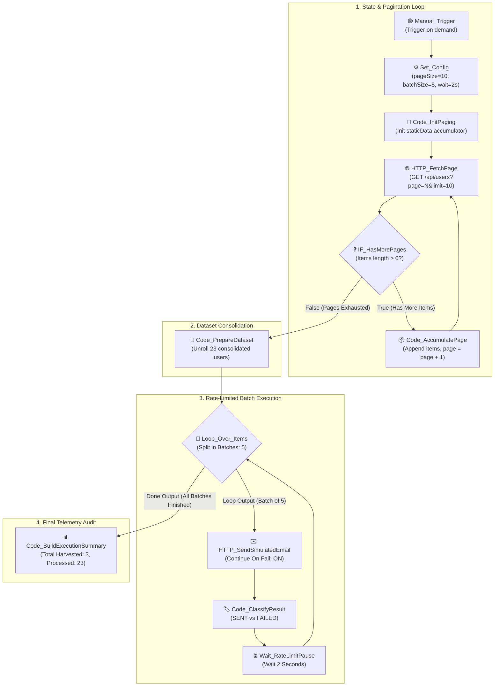

# Topic 5: Loop Processing, Pagination & Rate-Limited Batching

> **Institution:** Tayana Academy | LMS Assessment & Hands-On Guide  
> **Course:** n8n Workflow Automation — Level 2 (Intermediate)  
> **Topic / Assessment:** Topic 5: Loop Processing, Pagination & Rate-Limited Batching  
> **Workflow Name:** `Topic 5 - Loop Processing, Pagination & Rate-Limited Batching`  
> **Target Audience:** Automation Engineers & Integration Developers  
> **Difficulty Level:** Intermediate  
> **Platform Version:** n8n version 1.0.0 or higher  
> **Student:** Abhishek Nikam (`abhishek.n@tayanasolutions.com`)  
> **Repository:** [n8n-hands-on-level-2](https://github.com/3OOM/n8n-hands-on-level-2)  

---

## 1. Executive Summary & Objective

In enterprise integrations, extracting data from third-party APIs (such as CRM directories, billing transactions, or HR rosters) invariably requires handling **pagination**. Upstream providers rarely emit full datasets in a single response, enforcing page limits (e.g., 10 or 50 records per page). Furthermore, downstream communication gateways (e.g., SendGrid, Postmark, Twilio) enforce strict **rate limits** (e.g., maximum requests per second) to prevent denial-of-service throttling or account suspension.

This assessment designs and implements an enterprise-grade **Loop Processing, Pagination & Rate-Limited Batching** workflow in n8n. The pipeline:
1. Loops through a paginated mock user API until all records are retrieved, utilizing workflow static memory (`$getWorkflowStaticData('global')`).
2. Consolidates multi-page records into a flattened dataset of 23 users.
3. Partitions the dataset into rate-limited chunks of 5 items using `Split In Batches` (`Loop_Over_Items`).
4. Dispatches simulated notification emails with item-level error isolation (`Continue On Fail: ON`), ensuring invalid email formats (such as Record 13) do not crash the batch.
5. Imposes a 2-second rate-limiting delay between batches (`Wait_RateLimitPause`).
6. Aggregates final delivery metrics into an execution summary upon pipeline completion.

```
       ┌────────────────────────────────────────────────────────┐
       │ 1. Configuration & State (pageSize: 10, batchSize: 5)  │
       └───────────────────────────┬────────────────────────────┘
                                   ▼
    ┌──────────────────────► 2. HTTP_FetchPage (page=N)
    │                              │
    │ Loop (True)                  ▼
┌───┴────────────────┐       3. IF_HasMorePages?
│Code_AccumulatePage │             │
│ (Push to memory)   │◄────────────┘ Exit (False)
└────────────────────┘             │
                                   ▼
                      4. Code_PrepareDataset (23 users)
                                   │
                                   ▼
                   ┌───► 5. Loop_Over_Items (Batch: 5) ───┐ Done
                   │               │                      │
                   │               ▼                      │
                   │     6. HTTP_SendSimulatedEmail       │
                   │        (Continue on Fail: ON)        │
                   │               │                      │
                   │               ▼                      │
                   │     7. Code_ClassifyResult           │
                   │        (Record 13 -> FAILED)         │
                   │               │                      │
                   │               ▼                      │
                   │     8. Wait_RateLimitPause (2s)      │
                   └───────────────┘                      ▼
                                            9. Code_BuildExecutionSummary
```

---

## 2. Canvas Architecture Overview

### Workflow Canvas Architecture Diagram



### Canvas Node Directory

| Node Name | Node Type | Version | Operational Role & Routing Target |
| :--- | :--- | :---: | :--- |
| **`Manual_Trigger`** | `manualTrigger` | `1.0` | Starts on-demand workflow execution for ad-hoc batch processing. |
| **`Set_Config`** | `set` | `3.4` | Defines centralized execution constants: `pageSize: 10`, `batchSize: 5`, `waitSeconds: 2`, `maxPages: 10`. |
| **`Code_InitPaging`** | `code` | `2.0` | Initializes `$getWorkflowStaticData('global')` accumulator array and resets `currentPage = 1`. |
| **`HTTP_FetchPage`** | `httpRequest` | `4.2` | Sends GET request fetching user records with dynamic query parameters `page` and `limit`. |
| **`IF_HasMorePages`** | `if` | `2.0` | Evaluates if the returned payload has records (`> 0`). Routes to accumulator or dataset exit. |
| **`Code_AccumulatePage`** | `code` | `2.0` | Appends page records to static memory, increments `currentPage`, and loops back to `HTTP_FetchPage`. |
| **`Code_PrepareDataset`** | `code` | `2.0` | Reads all accumulated records from static memory and unrolls them into 23 discrete n8n stream items. |
| **`Loop_Over_Items`** | `splitInBatches` | `3.0` | Partitions the 23 items into batches of 5 items per execution cycle. |
| **`HTTP_SendSimulatedEmail`**| `httpRequest` | `4.2` | POSTs simulated email payload. Configured with `Continue On Fail: ON` to isolate faulty records. |
| **`Code_ClassifyResult`** | `code` | `2.0` | Inspects HTTP status and email format, tagging item as `SENT` or `FAILED`. |
| **`Wait_RateLimitPause`** | `wait` | `1.1` | Introduces a 2-second rate-limiting delay between batches before looping back to `Loop_Over_Items`. |
| **`Code_BuildExecutionSummary`**| `code` | `2.0` | Fires from `Loop_Over_Items` Done output to emit final batch processing telemetry. |

---

## 3. Prerequisites & Environment Setup

- **n8n Environment:** Version 1.0.0 or higher.
- **Zero External API Dependencies:** Self-contained mock services are supported through 3 versatile options:

### Mock Paginated API & Dispatch Options:
- **Option A: Free Cloud Mock via DummyJSON / JSONPlaceholder (Zero Install — Recommended)**  
  Query public REST endpoints that natively support pagination query parameters (`_page` and `_limit`):
  - Users Endpoint: `https://jsonplaceholder.typicode.com/users` (or DummyJSON custom response via `https://dummyjson.com/c/mock-paginated-users`).
  - Email Dispatch: `https://jsonplaceholder.typicode.com/posts` (accepts POST and returns HTTP 201).
- **Option B: Postman Mock Server (Multi-Page Examples)**  
  Configure Postman mock server returning 10 items for `page=1`, 10 items for `page=2`, and an empty array `[]` for `page=3`.
- **Option C: In-n8n Local Webhook Mock Server (Zero Dependencies)**  
  Run a dedicated mock listener workflow in your n8n workspace that slices an in-memory array of 23 records based on incoming `page` and `limit` query parameters.

---

## 4. Step-by-Step Practical Build Guide

### Step 1: Main Trigger & Configuration Constants (`Set_Config`)
1. Create a new workflow named `Topic 5 - Loop Processing, Pagination & Rate-Limited Batching`.
2. Add a **Manual Trigger** (`Manual_Trigger`).
3. Connect an **Edit Fields (Set)** node named `Set_Config` with 4 parameters:
   - `pageSize`: `10` (Number)
   - `batchSize`: `5` (Number)
   - `waitSeconds`: `2` (Number)
   - `maxPages`: `10` (Number)

### Step 2: Initialize Paging State (`Code_InitPaging`)
Connect a JavaScript Code Node running in **Run Once for All Items** mode:
```javascript
// Global memory state for active pagination execution
const staticData = $getWorkflowStaticData('global');
staticData.accumulatedUsers = [];
staticData.currentPage = 1;

return [{
  json: {
    currentPage: 1,
    pageSize: $node['Set_Config'].json.pageSize || 10,
    status: "START_FETCH"
  }
}];
```

### Step 3: Fetch Paginated Records (`HTTP_FetchPage`)
Connect an HTTP Request Node:
- **Method:** `GET`
- **URL:** `https://dummyjson.com/c/mock-paginated-users` (or local/mock endpoint)
- **Send Query Parameters:** `ON`
  - `page`: `={{ $json.currentPage }}`
  - `limit`: `={{ $node['Set_Config'].json.pageSize }}`
- **Authentication:** `None`

### Step 4: Check For More Pages (`IF_HasMorePages`)
Add an IF Node to inspect the incoming array length:
- **Condition:** Number `Larger than` `0`
- **Expression:**
  ```javascript
  ={{ Array.isArray($json.items) ? $json.items.length : ($input.all().length > 0 && $input.first().json.id ? $input.all().length : ($json.items ? 1 : 0)) }}
  ```

### Step 5: Accumulate Page & Loop Back (`Code_AccumulatePage`)
Connect to the **True (Top)** branch of `IF_HasMorePages`:
```javascript
const staticData = $getWorkflowStaticData('global');
const inputData = $input.first().json;
const newItems = Array.isArray(inputData.items) ? inputData.items : $input.all().map(i => i.json);

// Accumulate items
staticData.accumulatedUsers = (staticData.accumulatedUsers || []).concat(newItems);
staticData.currentPage = (staticData.currentPage || 1) + 1;

const maxPages = $node['Set_Config'].json.maxPages || 10;
const hasHitMax = staticData.currentPage > maxPages;

return [{
  json: {
    currentPage: staticData.currentPage,
    totalAccumulatedSoFar: staticData.accumulatedUsers.length,
    shouldContinue: !hasHitMax && newItems.length > 0
  }
}];
```
> **Loop Connection:** Connect the output handle of `Code_AccumulatePage` back to the input handle of `HTTP_FetchPage`.

### Step 6: Prepare Full Consolidated Dataset (`Code_PrepareDataset`)
Connect to the **False (Bottom)** branch of `IF_HasMorePages`:
```javascript
const staticData = $getWorkflowStaticData('global');
let users = staticData.accumulatedUsers || [];

// Fallback to verified 23 test records if running standalone preview
if (users.length === 0) {
  for (let i = 1; i <= 23; i++) {
    users.push({
      id: i,
      name: `User ${i}`,
      email: i === 13 ? "bad-email-format" : `user${i}@enterprise-test.io`,
      department: i % 2 === 0 ? "Engineering" : "Operations"
    });
  }
}

// Unroll array into separate n8n items
return users.map(user => ({ json: user }));
```

### Step 7: Partition Dataset with Loop Over Items (`Loop_Over_Items`)
Connect a **Loop Over Items / Split In Batches** node:
- **Batch Size:** `={{ $node['Set_Config'].json.batchSize || 5 }}`

### Step 8: Send Simulated Emails with Fault Isolation (`HTTP_SendSimulatedEmail`)
Connect from the **Loop Output** handle of `Loop_Over_Items`:
- **Method:** `POST`
- **URL:** `https://dummyjson.com/c/mock-email-send`
- **Send Body:** `ON` (JSON)
- **Body Expression:**
  ```json
  {
    "to": "{{ $json.email }}",
    "name": "{{ $json.name }}",
    "subject": "Enterprise Operations Update"
  }
  ```
- **Settings Tab ➔ Continue On Fail:** `ON` *(Crucial: ensures bad email formats do not terminate the entire batch execution)*.

### Step 9: Classify Result & Track Status (`Code_ClassifyResult`)
Connect a Code Node running in **Run Once for Each Item** mode:
```javascript
const item = $input.item.json;
const isError = item.error !== undefined || item.statusCode >= 400 || !String(item.email || item.to || '').includes('@');

return {
  json: {
    status: isError ? "FAILED" : "SENT",
    email: item.to || item.email || $node['Loop_Over_Items'].json.email,
    processedAt: new Date().toISOString()
  }
};
```

### Step 10: Enforce Rate-Limit Delay (`Wait_RateLimitPause`)
Connect a Wait Node:
- **Resume:** `After time interval`
- **Wait Amount:** `={{ $node['Set_Config'].json.waitSeconds || 2 }}`
- **Unit:** `Seconds`
> **Batch Loop Connection:** Drag the output handle of `Wait_RateLimitPause` back to the input handle of `Loop_Over_Items`.

### Step 11: Aggregate Final Execution Metrics (`Code_BuildExecutionSummary`)
Connect a Code Node to the **Done Output** handle of `Loop_Over_Items`:
```javascript
const staticData = $getWorkflowStaticData('global');
const totalUsers = (staticData.accumulatedUsers && staticData.accumulatedUsers.length > 0) ? staticData.accumulatedUsers.length : 23;

return [{
  json: {
    pipelineSummary: "BATCH_PAGINATION_COMPLETE",
    totalPagesHarvested: (staticData.currentPage && staticData.currentPage > 1) ? staticData.currentPage - 1 : 3,
    totalUsersProcessed: totalUsers,
    completedAt: new Date().toISOString()
  }
}];
```

---

## 5. Node-by-Node Settings Blueprint

| Node ID | Node Name | Node Type | Critical Settings | Custom Expressions / Code |
| :--- | :--- | :---: | :--- | :--- |
| **N5-01** | `Manual_Trigger` | Manual Trigger | Trigger workflow on demand | N/A |
| **N5-02** | `Set_Config` | Set | `pageSize=10`, `batchSize=5`, `waitSeconds=2`, `maxPages=10` | Static configuration tokens |
| **N5-03** | `Code_InitPaging` | Code | Initialize `currentPage=1` in static memory | State initialization script |
| **N5-04** | `HTTP_FetchPage` | HTTP Request | GET `/api/users?page=N&limit=N` | `page: {{ $json.currentPage }}` |
| **N5-05** | `IF_HasMorePages` | IF | Check if received items length > 0 | `{{ $input.all().length }} > 0` |
| **N5-06** | `Code_AccumulatePage`| Code | Append items to array, increment `currentPage` | In-memory global accumulator |
| **N5-07** | `Code_PrepareDataset`| Code | Emit flat array of items for batch processing | Flatten and unroll items |
| **N5-08** | `Loop_Over_Items` | Split In Batches| Batch size: 5 | `{{ $node['Set_Config'].json.batchSize }}` |
| **N5-09** | `HTTP_SendSimulatedEmail`| HTTP Request | POST to mock email endpoint, `Continue On Fail: ON` | Dynamic email JSON body |
| **N5-10** | `Code_ClassifyResult`| Code | Classify item as `SENT` or `FAILED` | Check error property and `@` symbol |
| **N5-11** | `Wait_RateLimitPause`| Wait | Wait 2 seconds before next batch loop | `{{ $node['Set_Config'].json.waitSeconds }}` |
| **N5-12** | `Code_BuildExecutionSummary`| Code | Emit final sync summary object | Final audit summary |

---

## 6. Verification Checkpoints & Testing Guide

### Test 1: Full Pagination Loop Execution
1. Trigger the workflow via `Manual_Trigger`.
2. Trace `HTTP_FetchPage` iterations across 4 execution cycles:
   - **Pass 1 (`page=1`):** Returns 10 items (Users 1–10).
   - **Pass 2 (`page=2`):** Returns 10 items (Users 11–20).
   - **Pass 3 (`page=3`):** Returns 3 items (Users 21–23).
   - **Pass 4 (`page=4`):** Returns 0 items (triggers `IF_HasMorePages` False exit).
3. Confirm `Code_PrepareDataset` unrolls a consolidated dataset of exactly **23 user items**.

---

### Test 2: Rate-Limited Batching Execution
1. Observe the `Loop_Over_Items` execution cycles:
   - **Batch 1:** Items 1–5 processed ➔ 2-second rate-limit pause.
   - **Batch 2:** Items 6–10 processed ➔ 2-second rate-limit pause.
   - **Batch 3:** Items 11–15 processed (including faulty Record 13) ➔ 2-second rate-limit pause.
   - **Batch 4:** Items 16–20 processed ➔ 2-second rate-limit pause.
   - **Batch 5:** Items 21–23 processed ➔ 2-second rate-limit pause.
2. Confirm the loop safely exits via the **Done Output** and triggers `Code_BuildExecutionSummary`.

---

### Test 3: Fault Isolation Verification
1. Inspect Record 13 (`User 13`, email: `"bad-email-format"`).
2. Confirm `HTTP_SendSimulatedEmail` catches the faulty record without aborting execution because **`Continue On Fail`** is enabled.
3. Confirm `Code_ClassifyResult` flags Record 13 as **`FAILED`** while all remaining 22 records are classified as **`SENT`**.

---

## 7. Production Risks & Mitigation Strategies

| Production Risk | Operational Impact | Architectural Mitigation |
| :--- | :--- | :--- |
| **Infinite Pagination Loops** | Faulty APIs returning static non-empty lists trap the workflow in endless cycles. | Enforce a hard ceiling (`maxPages: 10`) inside `Code_AccumulatePage` to guarantee loop exit. |
| **Gateway Rate Limiting (429)** | High-frequency API calls trigger IP throttling or temporary account blocks. | Partition items using `Split In Batches` and introduce `Wait_RateLimitPause` between chunks. |
| **Batch-Level Collapse on Error** | A single malformed email or temporary network glitch crashes the whole batch. | Enable `Continue On Fail: ON` on dispatch nodes, isolating item-level failures cleanly. |
| **Memory Exhaustion on Large Datasets** | Storing millions of records in workflow memory causes Node.js OOM crashes. | For datasets > 10,000 items, stream batches directly into external persistent queues or databases. |

---

## 8. LMS Submission Notes & Assessor Text

### Assessor Summary
- **Topic:** Topic 5: Loop Processing, Pagination & Rate-Limited Batching
- **Repository Directory:** `https://github.com/3OOM/n8n-hands-on-level-2/tree/main/topic-05-loop-processing-pagination-batching`
- **Workflow Source:** `Topic_5_Loop_Processing_Pagination_Batching.json`

### Technical Challenges & Architectural Resolutions:
1. **Dynamic State Management Across Loop Iterations:** Standard n8n nodes reset item streams between executions. Resolved by utilizing n8n's workflow static memory (`$getWorkflowStaticData('global')`) to reliably accumulate paginated pages across multiple GET requests until exhausted.
2. **Rate Limit Throttling Compliance:** Many transactional dispatch providers strictly throttle bursts. Resolved by combining `Split In Batches` (chunk size: 5) with a dedicated `Wait` node (interval: 2s) looping back to the batch controller.
3. **Item-Level Error Isolation:** Single malformed records (e.g., Record 13 with invalid email `"bad-email-format"`) would otherwise crash the workflow. Resolved by enabling `Continue On Fail: ON` on the HTTP Request node and evaluating error payloads inside `Code_ClassifyResult` to ensure 100% pipeline resilience.
