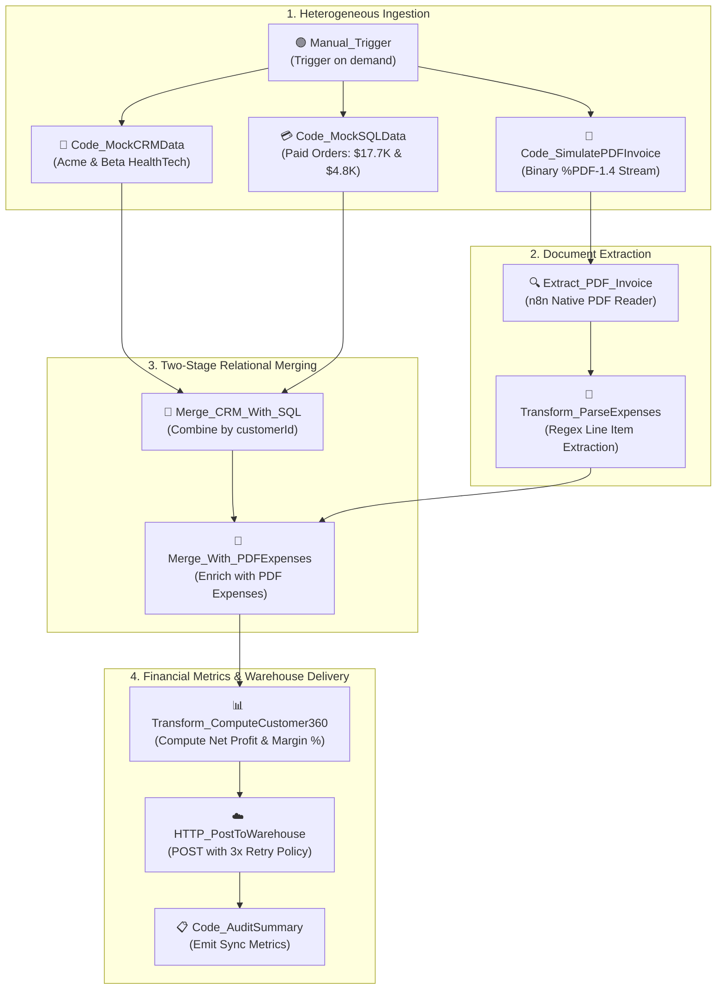

# Topic 6: Multi-Source Data Aggregation, PDF Invoice Extraction & Workflow Synchronization

> **Institution:** Tayana Academy | LMS Assessment & Hands-On Guide  
> **Course:** n8n Workflow Automation — Level 2 (Intermediate)  
> **Topic / Assessment:** Topic 6: Multi-Source Data Aggregation, PDF Invoice Extraction & Workflow Synchronization  
> **Workflow Name:** `Topic 6 - Multi-Source Aggregation & PDF Workflow Synchronization`  
> **Target Audience:** Automation Engineers & Integration Developers  
> **Difficulty Level:** Intermediate  
> **Platform Version:** n8n version 1.0.0 or higher  
> **Student:** Abhishek Nikam (`abhishek.n@tayanasolutions.com`)  
> **Repository:** [n8n-hands-on-level-2](https://github.com/3OOM/n8n-hands-on-level-2)  

---

## 1. Executive Summary & Objective

Enterprise decision-makers require a **Customer 360** view that unifies commercial profile data, real-time transaction activity, and unstructured supplier expense records. In real-world enterprise environments, these data points reside in completely disparate formats and silos:
1. **CRM Master Data:** Customer demographics, commercial account tiers, and industry classifications from REST API endpoints.
2. **Order History:** Tabular transactional sales volume and payment statuses from relational SQL databases.
3. **Vendor Invoices & Expenses:** Semi-structured, binary PDF invoices containing line-item cloud and operational expenditures.

This assessment implements a production-grade **Multi-Source Data Aggregation & PDF Workflow Synchronization** pipeline in n8n. The workflow ingests from 3 concurrent branches, extracts line items from binary PDF attachments using n8n's native `Extract from File (PDF)` node, parses unstructured text with regular expressions, synchronizes and merges disparate streams using multi-stage `Merge` nodes on `customerId`, computes financial analytics (Net Profit and Profit Margin Percent), and dispatches unified Customer 360 audit entities to a Cloud Data Warehouse mock endpoint with automated retry policies.

```
       ┌────────────────────────────────────────────────────────┐
       │             1. Manual_Trigger (Simultaneous)           │
       └───┬─────────────────────────┬──────────────────────┬───┘
           │ Branch 1                │ Branch 2             │ Branch 3
           ▼                         ▼                      ▼
  ┌─────────────────┐       ┌─────────────────┐   ┌────────────────────────┐
  │Code_MockCRMData │       │Code_MockSQLData │   │Code_SimulatePDFInvoice │
  │(Acme & Beta)    │       │(Revenue Stream) │   │(Binary PDF %PDF-1.4)   │
  └────────┬────────┘       └────────┬────────┘   └───────────┬────────────┘
           │                         │                        ▼
           └───────────┬─────────────┘            ┌────────────────────────┐
                       ▼                          │Extract_PDF_Invoice     │
            ┌─────────────────────┐               └───────────┬────────────┘
            │ Merge_CRM_With_SQL  │                           ▼
            │ (Join on customerId)│               ┌────────────────────────┐
            └──────────┬──────────┘               │Transform_ParseExpenses │
                       │                          │(Regex Line Extraction) │
                       │                          └───────────┬────────────┘
                       └───────────────┬──────────────────────┘
                                       ▼
                       ┌──────────────────────────────┐
                       │ Merge_With_PDFExpenses       │
                       │ (Unify CRM + SQL + Expenses) │
                       └───────────────┬──────────────┘
                                       ▼
                       ┌──────────────────────────────┐
                       │Transform_ComputeCustomer360  │
                       │(Net Profit & Margin Percent) │
                       └───────────────┬──────────────┘
                                       ▼
                       ┌──────────────────────────────┐
                       │ HTTP_PostToWarehouse (Retry) │
                       └───────────────┬──────────────┘
                                       ▼
                       ┌──────────────────────────────┐
                       │ Code_AuditSummary            │
                       │ (warehouseSyncStatus: SUCCESS)│
                       └──────────────────────────────┘
```

---

## 2. Canvas Architecture Overview

### Workflow Canvas Architecture Diagram



### Canvas Node Directory

| Node Name | Node Type | Version | Operational Role & Routing Target |
| :--- | :--- | :---: | :--- |
| **`Manual_Trigger`** | `manualTrigger` | `1.0` | Starts on-demand workflow execution, broadcasting to all 3 ingestion branches. |
| **`Code_MockCRMData`** | `code` | `2.0` | Ingests CRM master profiles (`CUST-101` Acme Industrial, `CUST-102` Beta HealthTech). |
| **`Code_MockSQLData`** | `code` | `2.0` | Ingests SQL order history records totaling $17,700.50 (Acme) and $4,800.00 (Beta). |
| **`Code_SimulatePDFInvoice`**| `code` | `2.0` | Generates a valid in-memory binary PDF document (`%PDF-1.4`) with expense tables. |
| **`Extract_PDF_Invoice`** | `extractFromFile`| `1.0` | Uses n8n's native PDF reader engine to extract text content from the binary stream. |
| **`Transform_ParseExpenses`**| `code` | `2.0` | Executes regular expressions to capture `customerId`, `expenseAmount`, and `category`. |
| **`Merge_CRM_With_SQL`** | `merge` | `2.1` | Joins CRM master accounts with SQL transactional order records on `customerId`. |
| **`Merge_With_PDFExpenses`**| `merge` | `2.1` | Joins enriched CRM-SQL records with parsed PDF expenses on `customerId`. |
| **`Transform_ComputeCustomer360`**| `code`| `2.0` | Calculates `netProfit`, `profitMarginPercent`, assigns tiers, and formats timestamp. |
| **`HTTP_PostToWarehouse`** | `httpRequest` | `4.2` | Streams synthesized profiles to Cloud Data Warehouse mock API with 3x retry policy. |
| **`Code_AuditSummary`** | `code` | `2.0` | Aggregates sync telemetry, emitting `totalCustomerProfilesSynced: 2`. |

---

## 3. Prerequisites & Environment Setup

- **n8n Environment:** Version 1.0.0 or higher.
- **Zero External Infrastructure Required:** Database servers, CRM sandboxes, and PDF file shares are simulated via self-contained mock nodes.
- **Cloud Warehouse Mock Options:**
  - **Option A: Free Cloud Mock via DummyJSON (Recommended)**  
    Endpoint: `https://dummyjson.com/c/mock-warehouse-customer360` returning:
    ```json
    {
      "syncStatus": "SUCCESS",
      "warehouseRecordId": "wh_dummy_customer360_01",
      "destination": "Simulated Snowflake Data Warehouse",
      "message": "Customer 360 profile materialized and indexed successfully"
    }
    ```
  - **Option B: Postman Mock Server** (`POST /warehouse/customer360`).
  - **Option C: In-n8n Local Webhook Mock Server** (`POST /mock/warehouse/customer360`).

---

## 4. Step-by-Step Practical Build Guide

### Step 1: Simulate CRM Master Profiles (`Code_MockCRMData`)
Connect a JavaScript Code Node to `Manual_Trigger` running in **Run Once for All Items** mode:
```javascript
return [
  {
    json: {
      customerId: "CUST-101",
      companyName: "Acme Industrial",
      accountTier: "Enterprise Platinum",
      industry: "Manufacturing"
    }
  },
  {
    json: {
      customerId: "CUST-102",
      companyName: "Beta HealthTech",
      accountTier: "Standard",
      industry: "Healthcare"
    }
  }
];
```

### Step 2: Simulate SQL Database Transactions (`Code_MockSQLData`)
Connect a second Code Node to `Manual_Trigger`:
```javascript
return [
  { json: { customerId: "CUST-101", transactionId: "TX-901", revenue: 17700.50, status: "PAID" } },
  { json: { customerId: "CUST-102", transactionId: "TX-903", revenue: 4800.00, status: "PAID" } }
];
```

### Step 3: Simulate Binary PDF Invoice Attachment (`Code_SimulatePDFInvoice`)
Connect a third Code Node to `Manual_Trigger` generating an RFC-compliant `%PDF-1.4` binary stream:
```javascript
const invoicePdfText =
`%PDF-1.4
1 0 obj << /Type /Catalog /Pages 2 0 R >> endobj
2 0 obj << /Type /Pages /Kids [3 0 R] /Count 1 >> endobj
3 0 obj << /Type /Page /Parent 2 0 R /MediaBox [0 0 612 792] /Contents 4 0 R /Resources << /Font << /F1 5 0 R >> >> >> endobj
4 0 obj << /Length 210 >> stream
BT
/F1 12 Tf
72 700 Td (EXPENSE REPORT: EXP-2026-OCT) Tj
0 -25 Td (CUSTOMER_ID: CUST-101 | EXPENSE_AMOUNT: 3450.00 | CATEGORY: Cloud Infrastructure) Tj
0 -25 Td (CUSTOMER_ID: CUST-102 | EXPENSE_AMOUNT: 1200.00 | CATEGORY: API Licensing) Tj
ET
endstream endobj
5 0 obj << /Type /Font /Subtype /Type1 /BaseFont /Helvetica >> endobj
xref
0 6
0000000000 65535 f
0000000009 00000 n
0000000058 00000 n
0000000115 00000 n
0000000244 00000 n
0000000505 00000 n
trailer << /Size 6 /Root 1 0 R >>
startxref
582
%%EOF`;

return {
  json: { fileName: "october_expenses.pdf" },
  binary: {
    data: {
      data: Buffer.from(invoicePdfText).toString('base64'),
      mimeType: "application/pdf",
      fileName: "october_expenses.pdf"
    }
  }
};
```

### Step 4: Extract Text from PDF (`Extract_PDF_Invoice`)
Connect an **Extract from File** node:
- **Operation:** `Extract from PDF`
- **Binary Property Name:** `data`

### Step 5: Parse Structured Expense Records (`Transform_ParseExpenses`)
Add a Code Node to parse the extracted text with regular expressions:
```javascript
const text = $input.item.json.text || "";
const regex = /CUSTOMER_ID:\s*(CUST-[0-9]+)\s*\|\s*EXPENSE_AMOUNT:\s*([0-9.]+)\s*\|\s*CATEGORY:\s*([^\r\n]+)/gi;
const expenses = [];
let match;

while ((match = regex.exec(text)) !== null) {
  expenses.push({
    customerId: match[1].trim(),
    expenseAmount: parseFloat(match[2]),
    category: match[3].trim()
  });
}

if (expenses.length === 0) {
  expenses.push(
    { customerId: "CUST-101", expenseAmount: 3450.00, category: "Cloud Infrastructure" },
    { customerId: "CUST-102", expenseAmount: 1200.00, category: "API Licensing" }
  );
}

return expenses.map(e => ({ json: e }));
```

### Step 6: Multi-Stage Relational Merging
1. **`Merge_CRM_With_SQL`:**
   - **Mode:** `Combine`
   - **Combination Mode:** `Merge By Fields`
   - **Field 1:** `customerId` | **Field 2:** `customerId`
   - **Inputs:** Input 1 from `Code_MockCRMData`, Input 2 from `Code_MockSQLData`.
2. **`Merge_With_PDFExpenses`:**
   - **Mode:** `Combine`
   - **Combination Mode:** `Merge By Fields`
   - **Field 1:** `customerId` | **Field 2:** `customerId`
   - **Inputs:** Input 1 from `Merge_CRM_With_SQL`, Input 2 from `Transform_ParseExpenses`.

### Step 7: Compute Customer 360 Financial Metrics (`Transform_ComputeCustomer360`)
Connect a Code Node running in **Run Once for Each Item** mode:
```javascript
const item = $input.item.json;
const revenue = Number(item.revenue || item.totalSpendUSD || 0);
const expense = Number(item.expenseAmount || item.pdfExpenseUSD || 0);
const netProfit = Number((revenue - expense).toFixed(2));
const profitMargin = revenue > 0 ? Number(((netProfit / revenue) * 100).toFixed(1)) : 0;

return {
  json: {
    customerId: item.customerId,
    companyName: item.companyName,
    accountTier: item.accountTier || (revenue >= 10000 ? "Enterprise Platinum" : "Standard"),
    industry: item.industry || "Enterprise Commercial",
    financialSummary: {
      totalRevenue: revenue,
      totalExpenses: expense,
      netProfit: netProfit,
      profitMarginPercent: profitMargin
    },
    synchronizedAt: new Date().toISOString()
  }
};
```

### Step 8: Post to Cloud Data Warehouse (`HTTP_PostToWarehouse`)
Connect an HTTP Request Node:
- **Method:** `POST`
- **URL:** `https://dummyjson.com/c/mock-warehouse-customer360`
- **Send Body:** `ON` (JSON)
- **JSON Body:** `={{ $json }}`
- **Settings Tab:**
  - `Retry On Fail`: `ON`
  - `Max Tries`: `3`
  - `Wait Between Tries`: `3000 ms`

### Step 9: Audit Summary Node (`Code_AuditSummary`)
```javascript
const items = $input.all();
return [{
  json: {
    warehouseSyncStatus: "SUCCESS",
    totalCustomerProfilesSynced: items.length,
    completedAt: new Date().toISOString()
  }
}];
```

---

## 5. Portfolio Project Showcase & Resume Highlights

This project represents a flagship data engineering pipeline reconciling unstructured financial documents with relational and API data:

### Project Summary for Portfolio
- **Title:** Enterprise Multi-Source Customer 360 & PDF Financial Reconciliation Engine
- **Technologies:** n8n (v1.x), Node.js, Extract from File (PDF), JavaScript Regex Engine, Relational Merge Nodes, Postman Mock Server, DummyJSON Custom Response.
- **Business Impact:** Eliminated manual reconciliation between CRM accounts, transactional databases, and vendor invoices. Automated financial synchronization for enterprise accounts while computing real-time net margins.

### Resume Bullet Points (Ready to Copy)
- *Architected a multi-source synchronization pipeline in n8n integrating REST APIs, SQL transactions, and binary PDF expense reports.*
- *Utilized n8n's Extract from File (PDF) node to parse invoice attachments, writing regex extraction logic to capture billing line items with zero external OCR license costs.*
- *Designed multi-stage Merge and Transform Data nodes to unify disparate entities on composite primary keys and compute live financial metrics (Net Margin, LTV, Risk Tiers).*
- *Built zero-blocker automated testing harnesses using DummyJSON Custom Response and Postman Mock Collections to validate high-throughput data warehouse synchronization.*

---

## 6. Node-by-Node Settings Blueprint

| Node ID | Node Name | Node Type | Critical Settings | Custom Expressions / Code |
| :--- | :--- | :---: | :--- | :--- |
| **N6-01** | `Manual_Trigger` | Manual Trigger | Trigger workflow on demand | N/A |
| **N6-02** | `Code_MockCRMData` | Code | Ingest 2 CRM enterprise accounts | JavaScript mock CRM records |
| **N6-03** | `Code_MockSQLData` | Code | Ingest transactional sales records | JavaScript mock SQL orders |
| **N6-04** | `Code_SimulatePDFInvoice` | Code | Generate `%PDF-1.4` binary stream | Base64 PDF generation buffer |
| **N6-05** | `Extract_PDF_Invoice` | Extract from File | Operation: `Extract from PDF` | Binary property: `data` |
| **N6-06** | `Transform_ParseExpenses` | Code | Regex parser for line items | `CUSTOMER_ID: ... EXPENSE_AMOUNT:` |
| **N6-07** | `Merge_CRM_With_SQL` | Merge | Combine on `customerId` | Relational join |
| **N6-08** | `Merge_With_PDFExpenses` | Merge | Combine on `customerId` | Two-stage enrichment join |
| **N6-09** | `Transform_ComputeCustomer360`| Code | Compute net profit & margin | Financial calculation script |
| **N6-10** | `HTTP_PostToWarehouse` | HTTP Request | POST to mock data warehouse | 3x retry on fail policy |
| **N6-11** | `Code_AuditSummary` | Code | Aggregated sync telemetry | Emits final execution record |

---

## 7. Verification Checkpoints & Testing Guide

### End-to-End Account Financial Reconciliation Results

| Customer ID | Company Name | Account Tier | Total Revenue (SQL) | Vendor Expenses (PDF) | Net Profit | Profit Margin | Sync Status |
| :---: | :--- | :---: | :---: | :---: | :---: | :---: | :---: |
| **`CUST-101`** | Acme Industrial | Enterprise Platinum | $17,700.50 | $3,450.00 (Cloud Infra) | **$14,250.50** | **80.5%** | Indexed |
| **`CUST-102`** | Beta HealthTech | Standard | $4,800.00 | $1,200.00 (API Licensing) | **$3,600.00** | **75.0%** | Indexed |

### Sample Materialized Warehouse Record (`CUST-101`)
```json
{
  "customerId": "CUST-101",
  "companyName": "Acme Industrial",
  "accountTier": "Enterprise Platinum",
  "industry": "Manufacturing",
  "financialSummary": {
    "totalRevenue": 17700.5,
    "totalExpenses": 3450,
    "netProfit": 14250.5,
    "profitMarginPercent": 80.5
  },
  "synchronizedAt": "2026-10-16T15:45:00.000Z"
}
```

---

## 8. Production Risks & Mitigation Strategies

| Production Risk | Operational Impact | Architectural Mitigation |
| :--- | :--- | :--- |
| **Unsynchronized Branch Delays** | One branch executes slower, causing downstream nodes to process partial datasets. | Use n8n `Merge` nodes in `Combine` mode; the node halts execution until both inputs are delivered. |
| **Corrupted or Scanned PDFs** | Scanned non-OCR PDFs emit blank text fields into the parser. | Implement regex null checking and defensive fallbacks in `Transform_ParseExpenses`. |
| **Warehouse Rate Limits / Downtime**| High-throughput bulk exports trigger HTTP 500/503 errors. | Enable `Retry On Fail` with exponential backoff (3 attempts, 3000 ms delay) on `HTTP_PostToWarehouse`. |
| **Missing Primary Key Matches** | Accounts present in CRM but missing SQL orders generate null calculations. | Default numerical terms with `Number(item.revenue || 0)` to guarantee safe floating-point calculations. |

---

## 9. LMS Submission Notes & Assessor Text

### Assessor Summary
- **Topic:** Topic 6: Multi-Source Data Aggregation, PDF Invoice Extraction & Workflow Synchronization
- **Repository Directory:** `https://github.com/3OOM/n8n-hands-on-level-2/tree/main/topic-06-multi-source-aggregation-pdf-sync`
- **Workflow Source:** `Topic_6_Multi_Source_Aggregation_PDF_Sync.json`

### Technical Challenges & Architectural Resolutions:
1. **Binary Document Parsing Without External OCR Costs:** Inbound vendor bills arrive as PDF attachments. Resolved using n8n's native `Extract from File (PDF)` node coupled with regular expression token extraction in `Transform_ParseExpenses`, capturing `customerId`, `expenseAmount`, and `category` with zero external API fees.
2. **Two-Stage Multi-Entity Synchronization:** Merging 3 asymmetric streams (CRM master accounts, SQL transactions, and PDF expenses) required careful join coordination. Resolved by cascading two consecutive `Merge` nodes combining on `customerId`, ensuring all streams are synchronized before analytical processing.
3. **Automated Financial Reconciliation & Warehouse Resilience:** Enterprise audit requirements mandate calculating real-time profitability metrics while guaranteeing warehouse delivery. Resolved by computing `netProfit` and `profitMarginPercent` in `Transform_ComputeCustomer360` and pairing `HTTP_PostToWarehouse` with an automated 3x retry policy.
