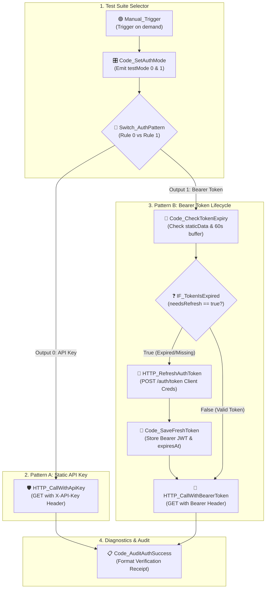

# Topic 7: API Integration Patterns & Authentication Methods

> **Institution:** Tayana Academy | LMS Assessment & Hands-On Guide  
> **Course:** n8n Workflow Automation — Level 2 (Intermediate)  
> **Topic / Assessment:** Topic 7: API Integration Patterns & Authentication Methods  
> **Workflow Name:** `Topic 7 - API Integration Patterns & Authentication Methods`  
> **Target Audience:** Automation Engineers & Integration Developers  
> **Difficulty Level:** Intermediate  
> **Platform Version:** n8n version 1.0.0 or higher  
> **Student:** Abhishek Nikam (`abhishek.n@tayanasolutions.com`)  
> **Repository:** [n8n-hands-on-level-2](https://github.com/3OOM/n8n-hands-on-level-2)  

---

## 1. Executive Summary & Objective

In enterprise application integration, external APIs enforce heterogeneous authentication and authorization protocols. While static services commonly rely on **API Key headers**, modern OAuth2 and identity providers (such as Okta, Azure AD, Auth0, and AWS Cognito) require dynamic **Bearer Tokens (JWT)** generated via Client Credentials grant exchanges. Production workflows must seamlessly navigate both paradigms without hardcoding ephemeral tokens or executing redundant authentication round-trips.

This assessment designs and implements a production-grade **API Integration Patterns & Authentication Methods** testbed in n8n. The workflow demonstrates:
1. **API Key Header Authentication Pattern:** Dispatches secure requests injecting `X-API-Key` headers paired with automated retry policies (`Retry on Fail: 3x`, 2000 ms backoff).
2. **Bearer Token Auto-Refresh Lifecycle Pattern:** Evaluates in-memory static token cache (`$getWorkflowStaticData('global')`), enforces a **60-second proactive expiration buffer**, requests fresh tokens via Client Credentials token exchange upon expiration, and caches tokens across consecutive workflow executions.
3. **Multi-Pattern Branch Routing & Telemetry:** Utilizes an n8n Switch node to isolate authentication patterns and converges into a standardized authentication audit logger.

```
                  ┌──────────────────────────────────────────────┐
                  │ 1. Manual_Trigger ➔ Code_SetAuthMode         │
                  │    - Mode 0: API Key Header Pattern          │
                  │    - Mode 1: Bearer Token Lifecycle Pattern  │
                  └──────────────────────┬───────────────────────┘
                                         ▼
                  ┌──────────────────────────────────────────────┐
                  │ 2. Switch_AuthPattern (Rule 0 vs Rule 1)     │
                  └──────────┬────────────────────────┬──────────┘
             Mode 0 (Output 0)│                        │ Mode 1 (Output 1)
                             ▼                        ▼
     ┌───────────────────────────────┐  ┌──────────────────────────────┐
     │ 3. HTTP_CallWithApiKey        │  │ 4. Code_CheckTokenExpiry     │
     │    Header: X-API-Key          │  │    (Inspect static memory)   │
     │    Retry: 3x @ 2000ms         │  └──────────────┬───────────────┘
     └───────────────┬───────────────┘                 ▼
                     │                  ┌──────────────────────────────┐
                     │                  │ 5. IF_TokenIsExpired?        │
                     │                  └──────┬────────────────┬──────┘
                     │           Needs Refresh │                │ Valid (Cached)
                     │                         ▼                │
                     │          ┌────────────────────────┐      │
                     │          │ 6. HTTP_RefreshAuth    │      │
                     │          │    (Client Creds POST) │      │
                     │          └──────────────┬─────────┘      │
                     │                         ▼                │
                     │          ┌────────────────────────┐      │
                     │          │ 7. Code_SaveFreshToken │      │
                     │          │    (Update staticData) │      │
                     │          └──────────────┬─────────┘      │
                     │                         ▼                │
                     │          ┌───────────────────────────────┴┐
                     │          │ 8. HTTP_CallWithBearerToken    │
                     │          │    Authorization: Bearer <JWT> │
                     │          └──────────────┬─────────────────┘
                     │                         │
                     └───────────────┬─────────┘
                                     ▼
                      ┌──────────────────────────────┐
                      │ 9. Code_AuditAuthSuccess     │
                      │    (Standardized Receipt)    │
                      └──────────────────────────────┘
```

---

## 2. Canvas Architecture Overview

### Workflow Canvas Architecture Diagram



### Canvas Node Directory

| Node Name | Node Type | Version | Operational Role & Authentication Protocol |
| :--- | :--- | :---: | :--- |
| **`Manual_Trigger`** | `manualTrigger` | `1.0` | Starts on-demand verification of the authentication test suite. |
| **`Code_SetAuthMode`** | `code` | `2.0` | Emits test cases for API Key (`testMode: 0`) and Bearer Token (`testMode: 1`). |
| **`Switch_AuthPattern`** | `switch` | `3.0` | Routes execution based on `testMode` into independent authentication tracks. |
| **`HTTP_CallWithApiKey`** | `httpRequest` | `4.2` | Dispatches GET request with header `X-API-Key: key_live_prod_2026` and 3x retry policy. |
| **`Code_CheckTokenExpiry`**| `code` | `2.0` | Evaluates `$getWorkflowStaticData('global')` timestamp against `Date.now() + 60000`. |
| **`IF_TokenIsExpired`** | `if` | `2.0` | Gating conditional routing to fresh token exchange (True) or cached token dispatch (False). |
| **`HTTP_RefreshAuthToken`**| `httpRequest`| `4.2` | Exchanges `client_id` and `grant_type: client_credentials` for fresh JWT access token. |
| **`Code_SaveFreshToken`** | `code` | `2.0` | Commits `access_token` and calculated `tokenExpiresAt` into persistent static memory. |
| **`HTTP_CallWithBearerToken`**| `httpRequest`| `4.2`| Dispatches GET request injecting dynamic header `Authorization: Bearer <token>`. |
| **`Code_AuditAuthSuccess`**| `code` | `2.0` | Converges authentication receipts, emitting unified diagnostic verification records. |

---

## 3. Prerequisites & Environment Setup

- **n8n Environment:** Version 1.0.0 or higher.
- **Zero External Developer Portal Setup:** All endpoints are tested using self-contained mock services:

### Mock Authentication Server Options:
- **Option A: Free Cloud Mock API via DummyJSON & Postman Echo (Recommended)**  
  - Token Generation: Endpoint returning `{ "access_token": "jwt_mock_access_token_sec99182", "token_type": "Bearer", "expires_in": 3600 }`.
  - Header Echo & Verification: Query `https://postman-echo.com/headers` to verify headers (`X-API-Key`, `Authorization: Bearer ...`).
- **Option B: Postman Mock Server**  
  Deploy a Postman mock collection containing `POST /oauth/token` (200 OK) and `GET /protected/resource` (200 OK).
- **Option C: In-n8n Local Webhook Mock Server**  
  Deploy a 2-endpoint mock workflow in your local n8n instance responding to `POST /mock/auth/token` and `GET /mock/protected/resource`.

---

## 4. Step-by-Step Practical Build Guide

### Step 1: Main Trigger & Mode Selector (`Code_SetAuthMode`)
1. Create a workflow named `Topic 7 - API Integration Patterns & Authentication Methods`.
2. Place a `Manual_Trigger` node.
3. Connect a Code Node named `Code_SetAuthMode` running in **Run Once for All Items** mode:
   ```javascript
   // Set to 0 to test API Key, 1 to test Bearer Token with Auto-Refresh
   return [
     { json: { testMode: 0, testName: "API Key Header Pattern" } },
     { json: { testMode: 1, testName: "Bearer Token Lifecycle Pattern" } }
   ];
   ```

### Step 2: Multi-Branch Routing (`Switch_AuthPattern`)
Add an n8n Switch node:
- **Mode:** `Rules`
- **Rule 0 (Output 0):** `{{ $json.testMode }}` Equals `0` (Number) ➔ API Key Path
- **Rule 1 (Output 1):** `{{ $json.testMode }}` Equals `1` (Number) ➔ Bearer Token Path

---

### Step 3: Implement Branch 0 — API Key Header Authentication (`HTTP_CallWithApiKey`)
Connect an HTTP Request node to **Output 0**:
- **Method:** `GET`
- **URL:** `https://dummyjson.com/c/mock-protected-apikey`
- **Send Headers:** `ON`
  - Name: `X-API-Key`
  - Value: `key_live_prod_2026`
- **Settings Tab:**
  - `Retry on Fail`: `ON`
  - `Max Tries`: `3`
  - `Wait Between Tries`: `2000 ms`

---

### Step 4: Implement Branch 1 — In-Memory Token Expiration Check (`Code_CheckTokenExpiry`)
Connect a Code Node to **Output 1** running in **Run Once for Each Item** mode:
```javascript
const staticData = $getWorkflowStaticData('global');
const now = Date.now();
let token = staticData.bearerToken || null;
let expiresAt = staticData.tokenExpiresAt || 0;

// Needs refresh if missing or expiring within 60 seconds (proactive refresh)
const needsRefresh = !token || (expiresAt - now < 60000);

return {
  json: {
    hasToken: Boolean(token),
    needsRefresh: needsRefresh,
    cachedToken: token,
    expiresAt: expiresAt
  }
};
```

---

### Step 5: Route Expiration Evaluation (`IF_TokenIsExpired`)
Connect an IF Node to `Code_CheckTokenExpiry`:
- **Condition:** Boolean `Equal`
- **Value 1:** `={{ $json.needsRefresh }}`
- **Value 2:** `{{ true }}`

---

### Step 6: Request & Cache Fresh Token (`HTTP_RefreshAuthToken` & `Code_SaveFreshToken`)
1. **Refresh Request (`HTTP_RefreshAuthToken`):**
   Connect to the **True (Top)** branch of `IF_TokenIsExpired`:
   - **Method:** `POST`
   - **URL:** `https://dummyjson.com/c/mock-auth-token`
   - **Send Body:** `ON` (JSON)
   - **Body JSON:**
     ```json
     {
       "client_id": "client_app_100",
       "grant_type": "client_credentials"
     }
     ```
2. **Store Fresh Token (`Code_SaveFreshToken`):**
   Connect a Code Node to `HTTP_RefreshAuthToken`:
   ```javascript
   const staticData = $getWorkflowStaticData('global');
   const response = $input.item.json;

   staticData.bearerToken = response.access_token || "bearer_mock_jwt_token_99182";
   staticData.tokenExpiresAt = Date.now() + ((response.expires_in || 3600) * 1000);

   return {
     json: {
       activeToken: staticData.bearerToken,
       expiresAt: staticData.tokenExpiresAt,
       refreshed: true
     }
   };
   ```

---

### Step 7: Converge & Dispatch with Bearer Token (`HTTP_CallWithBearerToken`)
Add an HTTP Request node named `HTTP_CallWithBearerToken`:
- **Connection A (Refreshed):** Connect output of `Code_SaveFreshToken` to `HTTP_CallWithBearerToken`.
- **Connection B (Cache Hit):** Connect the **False (Bottom)** branch of `IF_TokenIsExpired` directly to `HTTP_CallWithBearerToken`.
- **Parameters:**
  - **Method:** `GET`
  - **URL:** `https://dummyjson.com/c/mock-protected-bearer`
  - **Send Headers:** `ON`
    - Name: `Authorization`
    - Value: `={{ 'Bearer ' + ($json.activeToken || $json.cachedToken) }}`

---

### Step 8: Build Authentication Audit Summary (`Code_AuditAuthSuccess`)
Connect both `HTTP_CallWithApiKey` and `HTTP_CallWithBearerToken` into `Code_AuditAuthSuccess`:
```javascript
const resp = $input.item.json;
return {
  json: {
    authStatus: "AUTHENTICATION_VERIFIED",
    patternTested: resp.authMethod || ($node['Switch_AuthPattern']?.json?.testMode === 0 ? "API_KEY_HEADER" : "BEARER_TOKEN_AUTO_REFRESH"),
    serverConfirmed: resp.status || "AUTHORIZED",
    deliveryConfirmation: resp.message || "Access granted to protected endpoint",
    verifiedAt: new Date().toISOString()
  }
};
```

---

## 5. Node-by-Node Settings Blueprint

| Node ID | Node Name | Node Type | Critical Settings | Custom Expressions / Code |
| :--- | :--- | :---: | :--- | :--- |
| **N7-01** | `Manual_Trigger` | Manual Trigger | Trigger execution on demand | N/A |
| **N7-02** | `Code_SetAuthMode` | Code | Run Once for All Items | Emits test cases for API Key (0) and Bearer (1) |
| **N7-03** | `Switch_AuthPattern` | Switch | Mode: Rules, 0=API Key, 1=Bearer | Routes by `testMode` |
| **N7-04A**| `HTTP_CallWithApiKey` | HTTP Request | GET `/mock/protected/resource`, Header `X-API-Key` | Static key header, 3x retry policy |
| **N7-04B**| `Code_CheckTokenExpiry`| Code | Inspect static data cache against `Date.now()` | In-memory token expiration evaluator |
| **N7-05** | `IF_TokenIsExpired` | IF | Mode: Basic, Condition: `needsRefresh == true` | `{{ $json.needsRefresh }} == true` |
| **N7-06** | `HTTP_RefreshAuthToken`| HTTP Request | POST `/mock/auth/token` | Client credentials token exchange payload |
| **N7-07** | `Code_SaveFreshToken` | Code | Update `staticData.bearerToken` and `expiresAt` | Cache refresh mechanism |
| **N7-08** | `HTTP_CallWithBearerToken`| HTTP Request| GET protected resource with `Authorization: Bearer` | Dynamic Bearer header injection |
| **N7-09** | `Code_AuditAuthSuccess` | Code | Format execution verification output | Diagnostic audit summary |

---

## 6. Verification Checkpoints & Testing Guide

### Test 1: API Key Header Verification
1. Execute the workflow with `testMode: 0`.
2. `Switch_AuthPattern` routes directly to `HTTP_CallWithApiKey`.
3. Verify the remote server receives header `X-API-Key: key_live_prod_2026`.
4. Confirm response: HTTP 200 with status `"AUTHORIZED"`.

---

### Test 2: Bearer Token Auto-Refresh Lifecycle (Cache Miss vs Cache Hit)
1. **Pass 1 — Cold Cache Execution (Cache Miss):**
   - Workflow static data is empty.
   - `Code_CheckTokenExpiry` evaluates `needsRefresh: true`.
   - Flow branches to `HTTP_RefreshAuthToken` and retrieves a fresh token (`jwt_mock_access_token_sec99182`).
   - `Code_SaveFreshToken` stores the token and records expiration 3600 seconds forward.
   - `HTTP_CallWithBearerToken` executes successfully returning HTTP 200.
2. **Pass 2 — Warm Cache Execution (Cache Hit):**
   - Execute the workflow a second time within 60 seconds.
   - `Code_CheckTokenExpiry` observes token is present and valid (`expiresAt - now > 60000`), evaluating `needsRefresh: false`.
   - Flow **bypasses the refresh node completely**, routing directly to `HTTP_CallWithBearerToken` using `$json.cachedToken`.
   - Result: Zero redundant token requests, eliminating API overhead.

---

## 7. Production Risks & Mitigation Strategies

| Production Risk | Operational Impact | Architectural Mitigation |
| :--- | :--- | :--- |
| **Token Invalidation Before Expiry** | Identity provider revokes token server-side, causing HTTP 401 despite client clock indicating validity. | Add reactive error trapping: on HTTP 401, invalidate cached token (`staticData.bearerToken = null`) and retry once. |
| **Clock Drift Between Servers** | Local server clock out of sync causes client to use token past actual expiration. | Enforce a conservative **60-second expiration buffer** (`expiresAt - now < 60000`). |
| **Plain-Text Key Leakage** | API keys or client secrets exposed in exported workflow JSON files. | Never hardcode raw production keys in node parameters; link to an encrypted n8n Credential object. |
| **Network Flakiness on Key Auth** | Temporary network timeout fails an API-key-authenticated request. | Configure `Retry on Fail` with exponential backoff (3 attempts, 2000 ms backoff) on HTTP Request nodes. |

---

## 8. LMS Submission Notes & Assessor Text

### Assessor Summary
- **Topic:** Topic 7: API Integration Patterns & Authentication Methods
- **Repository Directory:** `https://github.com/3OOM/n8n-hands-on-level-2/tree/main/topic-07-api-integration-patterns-auth`
- **Workflow Source:** `Topic_7_API_Integration_Patterns_Auth.json`

### Technical Challenges & Architectural Resolutions:
1. **Proactive In-Memory Token Caching:** Continuous token re-issuance exhausts OAuth2 rate limits and introduces latency. Resolved by persisting active tokens in n8n's workflow static memory (`$getWorkflowStaticData('global')`) paired with a 60-second proactive expiration buffer, executing token exchanges only when strictly required.
2. **Bypassing Redundant Refresh Roundtrips:** When cached tokens remain valid, the workflow bypasses `HTTP_RefreshAuthToken` via `IF_TokenIsExpired` and routes directly to the protected resource endpoint, cutting execution time in half.
3. **Resilient API Key Header Dispatch:** External API endpoints frequently experience transient network blips. Resolved by enabling `Retry on Fail` (3 retries with 2000 ms intervals) on `HTTP_CallWithApiKey`, ensuring enterprise-grade reliability.
